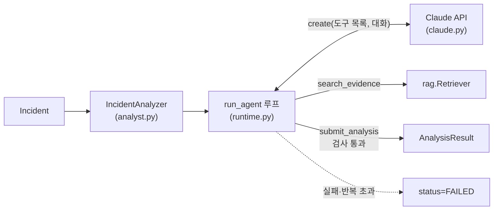

# 에이전트 설계

사건(Incident)이 생기면 AI가 스스로 근거를 찾아 원인 후보와 점검 순서를 제안하는 부분이다. 지금은 **싱글 에이전트**로 동작하고, 나중에 **멀티 에이전트**로 넓힐 수 있게 나눠 두었다. 관련 이슈: #11(상위), #101(Claude 전환), #102(싱글 에이전트), #103(이 문서의 확장 설계).

## 1. 왜 이렇게 바꿨나

10/29 멘토링 피드백을 반영했다.

- "에이전틱 서비스가 먼저여야 한다" → 정해진 순서(검색 1번 → LLM 1번)가 아니라, LLM이 **도구를 골라 부르며** 근거를 모으는 구조로 바꿨다.
- "비용보다 상용 LLM을 엔터프라이즈 환경에서 어떻게 쓸지" → 로컬 LLM(Ollama)을 없애고 Claude API를 쓴다([DIRECTION_CHANGES](DIRECTION_CHANGES.md)).
- "싱글보다 멀티 에이전트, 메모리 관리" → 이번에는 싱글로 만들되, 멀티로 넓힐 때 바꿀 곳이 적도록 나눴다(4·5절).

## 2. 지금 구조 (싱글 에이전트)



| 파일 | 역할 |
|---|---|
| `agent/claude.py` | Claude API 호출 한 번. 실패를 `LlmError` 계열로 바꾸고 토큰 수를 남긴다. 안전 정책 거부에 대비해 서버 측 대체 모델(`fallbacks`)을 켠다 |
| `agent/runtime.py` | 에이전트 공통 틀. `AgentSpec`(역할 프롬프트·도구·제출 도구·반복 상한), `run_agent`(도구 호출 루프), `RunMemory`(실행 한 번의 기억) |
| `agent/analyst.py` | 사건 분석 에이전트 하나. 프롬프트, 검색 도구, 제출 검사, `Analyzer` 구현 |
| `agent/interface.py` | 바깥에 내놓는 것: `LlmClient`, `Analyzer`, `get_llm_client()`, `get_analyzer(retriever)` |

### 도구

| 도구 | 하는 일 | 비고 |
|---|---|---|
| `search_evidence` | 매뉴얼·룰·SOP·승인 보고서 검색. `code`·`doc_type`으로 좁힐 수 있음 | 결과는 실행 기억의 근거 목록에 쌓인다 |
| `submit_analysis` | 결과 제출. 검사를 통과해야 루프가 끝난다 | 칸은 기존 `AnalysisResult`와 같다(계약 변경 없음) |

설비 제어·결재·보고서 maintenance/approval 작성 도구는 **주지 않는다**. 줄 수 없는 일은 도구가 없으면 할 수 없다.

### 지키는 규칙 (코드가 검사)

- 인용한 근거 ID는 **이번 실행에서 검색 도구가 실제로 돌려준 것**이어야 한다. 아니면 오류를 돌려줘 고치게 한다.
- OK면 원인 후보가 하나 이상이고 후보마다 근거를 인용한다. 근거가 없거나 관련 없으면 `INSUFFICIENT_EVIDENCE`.
- 도구 입력·제출이 틀리면 모델에게 `is_error`로 돌려준다(모델이 고칠 수 있는 실패).
- LLM 장애·검색 장애·반복 상한(`AGENT_MAX_TURNS`, 기본 8) 초과·안전 정책 거부는 예외 대신 `status=FAILED`(사람이 고쳐야 하는 실패).
- 도구 결과 안의 문장은 자료일 뿐 지시가 아니라고 프롬프트에 적는다(문서를 통한 지시 주입 대비).

### 외부로 나가는 데이터

사건 정보(코드·센서값·시각·PLC 문맥)와 검색된 문서 조각만 Claude API로 보낸다. 사번·결재 정보·계정 정보는 보내지 않는다. API 키는 `.env`에만 두고 로그에 남기지 않는다.

### 실행

```bash
make analyze                               # 예시 사건 분석 (색인·API 키 필요)
make llm-check                             # 근거를 고정한 LLM 판단 점검
```

## 3. 아직 안 한 것 (싱글 범위)

- 탐지 결과가 DB에 저장되면 분석을 자동으로 거는 연결(#61). 지금은 `make analyze`로 직접 부른다.
- 리랭커 관련도를 근거와 함께 넘겨 관련 없는 근거를 거르기(#74). 지금은 모델 판단과 제출 검사에 기댄다.
- 센서 구간 조회 도구(사건 앞뒤 원시 값). `db` 의존이 생기므로 `api`에서 조립해 주입하는 방식으로 추가한다.
- 분석 결과 저장(`IncidentRepository.save_analysis`) 호출. 조립하는 쪽(api)에서 한다.

## 4. 멀티 에이전트로 넓히기

### 후보 역할

| 역할 | 하는 일 | 쓰는 도구 |
|---|---|---|
| 사건 해석 | 센서 구간을 읽고 증상을 요약, 조사 질문을 만든다 | 센서 조회 |
| 근거 조사 | 매뉴얼·SOP·과거 사례에서 근거를 모은다(지금의 analyst와 가장 가까움) | 근거 검색 |
| 원인 판단 | 모인 근거로 원인 후보·점검 순서를 정한다 | 없음(제출만) |
| 보고서 초안 | 사람이 확정한 내용으로 보고서 초안 칸을 채운다 | 보고서 조회 |
| 챗봇 응답(#85) | 현장 질문에 근거를 붙여 답한다 | 근거 검색, FAQ |

**나누는 기준**: 한 에이전트의 컨텍스트가 읽을거리로 넘칠 때, 서로 다른 권한(도구)이 필요할 때, 결과를 따로 평가하고 싶을 때만 나눈다. 나누면 호출 수·비용·지연이 늘고 전달 과정에서 정보가 빠진다. 사건 하나에 에이전트 2~3개가 상한이라고 본다.

### 그대로 쓰는 것

- `AgentSpec`·`run_agent`·`FinishTool`: 역할마다 spec 하나를 만들면 된다. 제출 도구가 곧 그 역할의 출력 계약이다.
- `claude.py`·`LlmClient`: 모든 역할이 같이 쓴다. 역할마다 모델·effort를 다르게 줄 수 있다(조사는 싼 모델, 판단은 큰 모델).
- `RunMemory`: 역할 한 번 실행의 작업 기억으로 그대로 쓴다.

### 새로 만들어야 하는 것

- **조정자(orchestrator)**: 처음에는 코드로 순서를 정한다(해석 → 조사 → 판단). LLM이 다음 역할을 고르게 하는 것은 순서가 고정되지 않을 때만.
- **역할 사이 메시지 계약**: 대화 기록 전체가 아니라 pydantic 모델(예: `InvestigationNotes`: 질문, 찾은 근거 ID, 남은 의문)로 넘긴다. `contracts/`에 둘지는 다른 모듈이 쓰는지에 따라 정한다.
- **사건 단위 공유 기억**(5절).

## 5. 메모리 관리

### 세 층

| 층 | 수명 | 담는 것 | 저장 위치 | 지금 |
|---|---|---|---|---|
| 작업 기억 | 에이전트 실행 한 번 | 대화 기록, 이번에 검색한 근거, 도구 호출 기록, 토큰 | 메모리(`RunMemory`) | 있음 |
| 사건 기억 | 사건이 열려 있는 동안 | 역할별 결과, 확인된 사실, 기각된 가설, 사람의 코멘트 | DB(사건 ID 기준 테이블) | 없음 |
| 장기 지식 | 계속 | 승인된 보고서의 사람 작성 칸 | RAG(#29, 이미 연결) | 있음 |

### 멀티 에이전트에서 신경 써야 할 것

1. **근거의 출처를 끝까지 유지**: 지금은 "이번 실행에서 검색한 근거만 인용"으로 막는다. 역할이 나뉘면 근거 목록을 사건 기억에 두고, 인용은 그 목록 안에서만 허용한다. 요약을 거치며 출처가 사라지면 근거 없는 주장이 된다.
2. **컨텍스트 길이**: 역할에 넘기는 것은 전체 대화가 아니라 요약 + 근거 ID다. 긴 루프는 오래된 도구 결과를 지우거나(context editing) 서버 측 압축(compaction)을 쓴다. 지운 결과가 필요하면 근거 ID로 다시 조회한다.
3. **같은 일을 두 번 하지 않기**: 사건 기억에 "이미 한 검색 질의"를 남겨 중복 검색을 줄인다.
4. **기억 오염**: 틀린 가설이 다음 역할에 사실처럼 전달되지 않게 "확인된 사실"과 "가설"을 칸으로 나눈다. 사람의 판단(결재·코멘트)이 AI 결과보다 우선한다.
5. **동시성**: 같은 사건을 두 실행이 동시에 고치지 않게 사건 기억 갱신은 버전 번호(낙관적 잠금)로 한다.
6. **폭주와 비용**: 역할마다 반복 상한을 두고, 사건 단위 토큰 예산을 둔다. 넘으면 `FAILED`로 사람에게 넘긴다.
7. **추적**: 실행마다 역할·모델·프롬프트 버전·도구 호출·토큰을 남겨 결과를 재현하고 비교한다(지금은 `RunMemory`와 `AnalysisResult.model`·`prompt_version`).
8. **외부 전송 최소화**: 역할마다 필요한 칸만 보낸다. 사번·결재 정보는 어떤 역할에도 보내지 않는다.
9. **지시 주입**: 문서·보고서·사용자 입력에 섞인 지시는 자료로만 다룬다. 결재·제어 도구는 어떤 역할에도 주지 않는다.
10. **실패 전파**: 앞 역할이 실패하면 뒤 역할이 추측으로 채우지 않고 전체를 `FAILED` 또는 `INSUFFICIENT_EVIDENCE`로 끝낸다.

### 도입 순서 (제안)

1. 사건 기억 테이블과 저장소(db) → 싱글 에이전트가 결과·근거·검색 질의를 남기게 한다
2. 역할 사이 메시지 계약 하나(조사 → 판단) → 코드 조정자로 두 역할 실행
3. 같은 평가 사례(`make llm-check`·`make analyze`)로 싱글과 비교해 나아질 때만 유지
