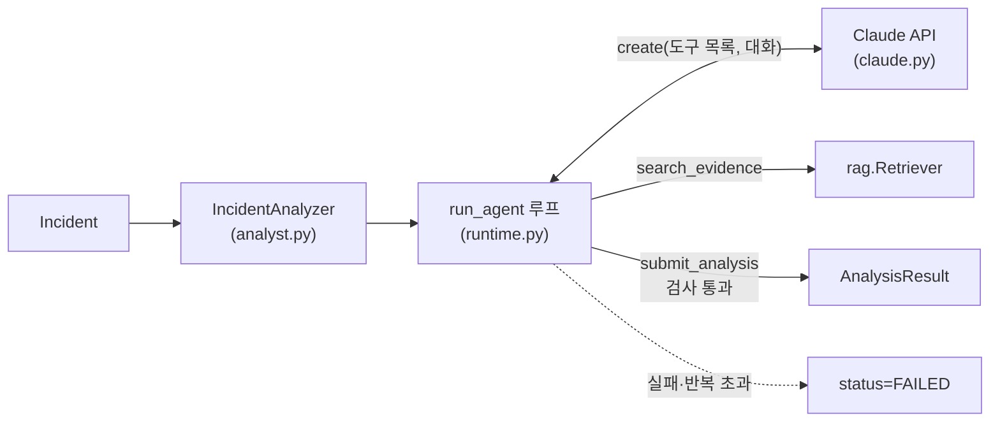

# 에이전트 설계

> 사건 자동 분석은 기존 단일 방식 외에 LangGraph 기반 멀티 방식을 선택할 수 있다.
> 공식 문서·정비이력 조사 → 통합 분석 → 선택 검증(수정 최대 1회)의 현재 구현·설정은
> [MULTI_AGENT_ANALYSIS](MULTI_AGENT_ANALYSIS.md)를 따른다. 아래 단일 실행기 설명은 유지한다.

사건(Incident)이 생기면 AI가 스스로 근거를 찾아 원인 후보와 점검 순서를 제안한다. 기본은 **싱글 에이전트**이며 자동 사건 분석에서 **멀티 에이전트**를 선택할 수 있다. 관련 이슈: #11(상위), #101(Claude 전환), #102(싱글 에이전트), #103(확장 설계).

## 1. 왜 이렇게 바꿨나

10/29 멘토링 피드백을 반영했다.

- "에이전틱 서비스가 먼저여야 한다" → 정해진 순서(검색 1번 → LLM 1번)가 아니라, LLM이 **도구를 골라 부르며** 근거를 모으는 구조로 바꿨다.
- "비용보다 상용 LLM을 엔터프라이즈 환경에서 어떻게 쓸지" → 로컬 LLM(Ollama)을 없애고 Claude API를 쓴다([DIRECTION_CHANGES](DIRECTION_CHANGES.md)).
- "싱글보다 멀티 에이전트, 메모리 관리" → 공통 실행기를 먼저 만들고 현재는 선택형 멀티 분석까지 구현했다(4·5절).

## 2. 지금 구조 (싱글 에이전트)



| 파일 | 역할 |
|---|---|
| `agent/claude.py` | Claude API 호출 한 번. 실패를 `LlmError` 계열로 바꾸고 토큰 수를 남긴다. 안전 정책 거부에 대비해 서버 측 대체 모델(`fallbacks`)을 켠다 |
| `agent/runtime.py` | 에이전트 공통 틀. `AgentSpec`(역할 프롬프트·도구·제출 도구·반복 상한), `run_agent`(도구 호출 루프), `RunMemory`(실행 한 번의 기억) |
| `agent/analyst.py` | 사건 분석 에이전트 하나. 프롬프트, 검색 도구, 제출 검사, `Analyzer` 구현 |
| `agent/interface.py` | 바깥에 내놓는 것: `LlmClient`, `Analyzer`, `get_llm_client()`, `get_analyzer(retriever)` |

### 도구

| 도구 | 하는 일 | 비고 |
|---|---|---|
| `search_evidence` | 매뉴얼·룰·SOP·승인 보고서 검색. `code`·`doc_type`으로 좁힐 수 있음 | 결과는 실행 기억의 근거 목록에 쌓인다 |
| `submit_analysis` | 결과 제출. 검사를 통과해야 루프가 끝난다 | `AnalysisResult`에 맞는 구조화 결과를 제출한다 |

설비 제어·결재·보고서 maintenance/approval 작성 도구는 **주지 않는다**. 줄 수 없는 일은 도구가 없으면 할 수 없다.

### 지키는 규칙 (코드가 검사)

- 인용한 근거 ID는 **이번 실행에서 검색 도구가 실제로 돌려준 것**이어야 한다. 아니면 오류를 돌려줘 고치게 한다.
- OK면 원인 후보가 하나 이상이고 후보마다 근거를 인용한다. 근거가 없거나 관련 없으면 `INSUFFICIENT_EVIDENCE`.
- 도구 입력·제출이 틀리면 모델에게 `is_error`로 돌려준다(모델이 고칠 수 있는 실패).
- LLM 장애·검색 장애·반복 상한(`AGENT_MAX_TURNS`, 기본 8) 초과·안전 정책 거부는 예외 대신 `status=FAILED`(사람이 고쳐야 하는 실패).
- 도구 결과 안의 문장은 자료일 뿐 지시가 아니라고 프롬프트에 적는다(문서를 통한 지시 주입 대비).

### 외부로 나가는 데이터

사건 정보(코드·센서값·시각·PLC 문맥)와 검색된 문서 조각을 Claude API로 보낸다.
계정 정보와 인증 키는 분석 입력으로 전달하지 않으며 키를 로그·단계 DB에 남기지 않는다.
멀티 분석은 앞 역할의 공개 결과와 센서 조회 요약도 입력으로 사용한다. 실제 키·SDK 인증
프로필은 AI가 열어 확인하지 않고 인증·유료 호출은 사용자가 자기 터미널에서 수행한다.

### 실행

```bash
make analyze                               # 예시 사건 분석 (색인·API 키 필요)
make llm-check                             # 근거를 고정한 LLM 판단 점검
```

실행 1번은 사용량 기록(Langfuse)에 trace 하나로 남는다. 사건 ID가 `session_id`, LLM 호출과 도구 호출이 그 아래 기록이다. 멀티 분석은 역할마다 agent 기록이 같은 사건 ID 아래 쌓인다([USAGE_TRACKING](USAGE_TRACKING.md)).

## 3. 연결 기능과 평가 범위

- #104의 탐지→DB→분석→결과 저장 연결은 [AUTO_ANALYSIS](AUTO_ANALYSIS.md)를 따른다.
  기본 비활성이며 `ANALYSIS_AUTO_ENABLED=true`로 켠다. `make analyze`는 별도 수동 실행 도구다.
- #74의 관련도 전달·필터링을 운영 평가에 적용하기. 검색 도구는 `relevance`를 전달하며,
  `None`은 미측정이다. RAG의 `RAG_MIN_RELEVANCE`를 설정하면 미달 근거는 실행 기억에
  들어가지 않아 인용할 수 없다. 기준값은 #75 실측 후 정한다. 검색·리랭커의 비정상
  출력은 도구 입력 수정 요청으로 돌리지 않고 `FAILED`로 처리한다.
- #105 센서 구간 조회·수치 대조는 [SENSOR_WINDOWS](SENSOR_WINDOWS.md)를 따른다.
  조회기는 `api`·스크립트에서 주입하며, Agent에는 선택 센서의 통계와 변화 시각을 전달한다.
- 자동 분석 결과·작업 완료는 #104의 전용 DB 트랜잭션으로 함께 저장한다.

## 4. 현재 멀티에이전트 구현

`ANALYSIS_MODE=multi`이면 `agent/multi_analysis.py`의 LangGraph가 다음 역할을 실행한다.
현재 구현·설정·DB·API·실패 처리의 상세 기준은 [MULTI_AGENT_ANALYSIS](MULTI_AGENT_ANALYSIS.md),
실제 프롬프트 조합과 제출 형식은 [MULTI_AGENT_PROMPTS](MULTI_AGENT_PROMPTS.md)를 따른다.

| 역할 | 담당 |
|---|---|
| 문서 조사 | 같은 설비의 공식 매뉴얼·SOP·룰에서 적용 기준·점검·안전 조건 조사 |
| 정비이력 조사 | 같은 설비·공정·에러코드의 승인 보고서에서 비교 가능한 대표 사례 최대 2건 선별 |
| 통합 분석 | 두 조사와 원문·기본 센서 조회를 결합해 원인 후보·점검·조치·참고 사례 생성 |
| 근거 검증(선택) | 통합 주장과 원문·사건·수치를 대조, 필요하면 한 번 수정·재검증 |

조사 두 역할은 병렬 실행하고 공유 검색기 호출은 직렬화한다. 각 역할은 기존
`AgentSpec`·`run_agent`·`FinishTool`·`RunMemory`를 재사용하며 독립 클라이언트를 가진다.
현재 역할별 모델·effort 설정은 분리하지 않고 공통 LLM 설정을 사용한다.
그래프가 고정된 흐름과 검증 결과에 따른 분기를 관리하며, LLM이 임의의 다음 역할을 고르지 않는다.

통합·검증은 조사에서 확보한 실제 원문을 함께 읽는다. 공식 문서가 충분하면 정비이력이
없어도 분석을 완료할 수 있으며 근거 없는 사례나 원인을 만들어 채우지 않는다.
보고서 초안은 기존 분석 결과를 폼에 연결하며 별도 보고서 작성 에이전트를 추가하지 않았다.
챗봇은 기존 별도 흐름을 유지한다.

## 5. 현재 기억·저장·재시도

| 층 | 담는 것 | 위치 | 현재 범위 |
|---|---|---|---|
| 역할 작업 기억 | 해당 역할의 대화·도구 호출·근거·센서 요약·사용량 | 프로세스 메모리 `RunMemory` | 역할 실행 중 사용. 전체 대화는 단계 DB에 저장하지 않음 |
| 단계별 기록 | 역할·차수별 공개 결과, 근거 원문, 센서 요약, 실행 통계 | PostgreSQL `analysis_agent_run` | 화면 조회·1/2차 비교·재사용 원본 추적 |
| 재개 입력 | 완료 단계와 근거·센서 조회·검증 설정 | PostgreSQL `analysis_checkpoint` | 실패 역할부터 수동 재시도. 전체 대화 중간 재개는 아님 |
| 작업·최종 결과 | 입력 스냅샷·실행 상태와 최종 분석 | PostgreSQL `analysis_job`, `analysis` | 사건·보고서 초안에 연결 |
| 장기 검색 지식 | 등록 문서와 최종 승인된 사람 작성 보고서 | 기존 RAG 벡터 저장소 | 중간 AI 결과는 자동 색인하지 않음 |

사건 단위 기록은 이미 존재한다. 다만 기각 가설·사용자 코멘트를 계속 학습하는 범용 장기
메모리, 실행 간 검색 질의 캐시, 대화 압축을 구현한 것은 아니다.

단계 결과와 재개 입력을 같은 트랜잭션으로 저장한다. 실패 작업의 새 수동 요청은 새 job으로
남기고 완료 단계·기본 센서 조회를 재사용한다. 원래 사건·원문 스냅샷을 유지하며 수정 횟수는
초기화하지 않는다. 실패한 역할 내부의 도구 루프는 처음부터 다시 실행한다.
이는 애플리케이션 체크포인트이며 LangGraph native checkpointer를 사용하지 않는다.

사건에 최종 승인 보고서가 있으면 재시도를 차단한다. 실제 사람 확인을 기다렸다가 재개하는
그래프, 성공 사건 전체 재분석, 문서 변경에 따른 완료 조사 무효화, 역할별 모델 선택,
자동 유료 재시작은 이후 검토 범위다.

## 6. 센서 구간 관측

기존 `get_sensor_window`와 수치 대조는 [SENSOR_WINDOWS](SENSOR_WINDOWS.md)를 따른다.
웹 멀티 분석에서는 통합 첫 호출 전에 마지막 감지 시각 이전 최대 120초를 서버가 기본 조회한다.
추가 LLM 호출이나 실시간 송신 대기를 만들지 않으며 표본 없음과 조회 실패를 구분한다.
조회 통계·출처·미관측 구간은 단계와 체크포인트에 보존하고 재시도에 재사용한다.
원시 센서 행은 `telemetry`에 있고 단계 공개 결과에는 조회 요약만 전달한다.
