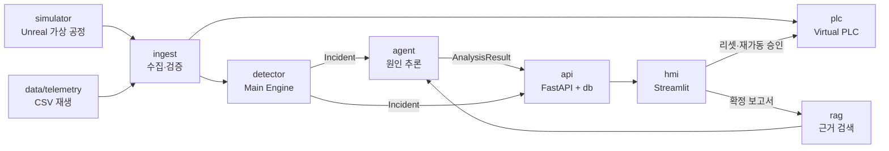

# 아키텍처와 모듈 경계

## 전체 흐름



- Virtual PLC는 FastAPI·Agent가 멈춰도 혼자 정지 판단을 할 수 있어야 한다. 그래서 detector와 따로 둔다.
- AI는 제안까지만 한다. 원인 확정, 정지 해제, 재가동은 사람이 HMI에서 한다.
- agent는 Claude가 근거 검색 도구를 골라 부르는 싱글 에이전트다. 구조와 멀티 에이전트 확장 계획은 [AGENT](AGENT.md).

## 모듈 표

| 모듈 | 하는 일 | 입력 → 출력 | 차수 |
|---|---|---|---|
| `contracts` | 모듈 간 데이터 모양 정의 | - | 0차 |
| `ingest` | CSV·시뮬레이터 수집, 검증, 재생 | 파일·스트림 → `TelemetryRecord` | 1차 |
| `detector` | 룰 판정, Incident 생성·갱신 | `TelemetryRecord` → `Incident` | 1~2차 |
| `rag` | 문서 색인, 근거 검색 | 문서 → `Evidence` | 1차 |
| `agent` | 원인 후보·점검 순서 생성 | `Incident` → `AnalysisResult` | 1차 |
| `api` | HTTP API, 모듈 연결 | HTTP JSON | 2차 |
| `db` | PostgreSQL 저장 | contracts 모델 ↔ 테이블 | 2차 |
| `plc` | 상태 전환, 보호 정지 | `TelemetryRecord` → `PlcState` | 3차 |
| `hmi/` | 대시보드, 보고서, 결재 | api 호출 | 5차 |
| `simulator/` | Unreal 연동 | 고장 주입 → Telemetry | 4차 |

각 모듈의 책임과 금지 사항은 `src/weeing_weeing/<모듈>/__init__.py` 첫 주석에, 바깥에 내놓는 함수 모양은 `<모듈>/interface.py`의 `Protocol`에 있다.

### 공통 룰 평가와 사건 연결

사건 센서 이력을 명시적으로 켜려면 `detector.interface.HistoryDetector`를 사용한다.
같은 모듈의 `RuleDetector.process_frame()`에서 입력을 한 번만 평가하고 후보 구간부터
회복 확정 행까지 수집한다. 파일 저장·공개 조회 API와 제약은
[INCIDENT_HISTORY](INCIDENT_HISTORY.md)를 따른다. 공통 Incident 계약은 변경하지 않는다.

`detector.interface.RuleDetector`가 `Detector` Protocol을 구현한다. 하나의 인스턴스를
유지하며, 사용 방법과 룰별 입력·정책은 [DETECTOR_RULES](DETECTOR_RULES.md)를 따른다.
`builtin_rules`의 순간 평가 → `rule_engine`의 지속·회복 확정 → `IncidentManager`
기록 순서다. 기존 `AnomalyDetector`와 전용 관측·상태 모델은 공통 평가 모델로 대체했다.
빈 평가 목록으로 회복을 추론하지 않는다.
기존 `P03Detector`는 P03만 활성화하는 호환용 래퍼다. Manager API와 공통 계약은
변경하지 않았다. JSON 시연은 공통 엔진을 사용하며 Agent/RAG는 호출하지 않는다.

## 의존 규칙

1. 모든 모듈은 `contracts`를 import할 수 있다.
2. 다른 모듈은 **`interface.py`만** import한다. 내부 파일을 직접 import하지 않는다.
3. 모듈을 서로 이어 붙이는 일은 `api`(또는 실행 스크립트)만 한다.
4. `plc`는 `api`·`agent`·`rag`를 import하지 않는다.

이 규칙을 지키면 나중에 모듈 하나를 별도 서비스로 떼어낼 때, `interface.py` 구현을 HTTP 클라이언트로 바꾸기만 하면 된다. 이때 `contracts` 모델이 그대로 요청·응답 JSON 스키마가 된다.

## 챗봇 경계 (#86)

`contracts/chat.py`의 질문·응답·출처 계약과 `agent/interface.py`의 `ChatService`를
추가한다. 기존 `Analyzer.analyze(Incident)`는 유지한다. `ChatService.reply()`는
질문·권한 검사를 마친 최근 문맥·전체 시간 예산을 받아 `ChatResponse`를 반환하는
동기 경계다. API가 인증·대화 소유권을 검사하고 허용된 검색 범위의 RAG와 공용 LLM을
주입하며 저장소 접근도 조립한다. agent가 db나 api 내부를 직접 import하지 않는다.

공용 상용 API는 #101/#107에서 구현된 `LlmClient`·`ClaudeClient`를 재사용한다.
`generate_json()`·`create()`·공급자·모델·`last_usage` 경계를 유지한다.
챗봇 생성·호출별 사용량 수집과 동시 호출 격리는 #89, 검색은 #88, 저장은 #90,
API 조립은 #91이다. 사용량 수집 시 공유 클라이언트의 `last_usage` 경합을 방지해야 한다.
보고서 정비·결재 작성이나 PLC 제어 도구는 챗봇에 제공하지 않는다.
API 경로·스레드 실행·타임아웃은 [CHATBOT](CHATBOT.md)의 제안이며 아직 실행되지 않는다.

## 폴더 구조

```
src/weeing_weeing/   파이썬 패키지 (모듈별 하위 폴더)
hmi/                 Streamlit 앱 (5차)
simulator/           Unreal 연동 메모·스크립트 (4차)
data/                원본 데이터와 지식 문서 (data/README.md)
scripts/             일회성·보조 스크립트 (합성 데이터 생성, 색인 실행 등)
tests/               pytest. 모듈 폴더 구조를 따라간다
docs/                설계·규칙 문서
.agents/skills/      팀 공용 에이전트 스킬 원본 (.claude/skills는 자동 생성 사본)
```
