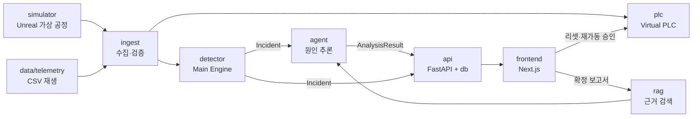

# 아키텍처와 모듈 경계

## 전체 흐름



- Virtual PLC는 FastAPI·Agent가 멈춰도 혼자 정지 판단을 할 수 있어야 한다. 그래서 detector와 따로 둔다.
- AI는 제안까지만 한다. 원인 확정, 정지 해제, 재가동은 사람이 HMI에서 한다.
- agent는 Claude가 근거 검색 도구를 골라 부르는 싱글 에이전트다. 구조와 멀티 에이전트 확장 계획은 [AGENT](AGENT.md).

## 모듈 표

| 모듈 | 하는 일 | 입력 → 출력 | 차수 |
|---|---|---|---|
| `contracts` | 모듈 간 데이터 모양 정의 | - | 0차 |
| `ingest` | CSV·시뮬레이터 수집, 검증, 재생 | 파일·스트림 → `TelemetryRecord` | 1차 |
| `detector` | 룰 판정, Incident 생성·갱신 | `TelemetryRecord` → `Incident` | 1~2차 |
| `rag` | 문서 색인, 근거 검색 | 문서 → `Evidence` | 1차 |
| `agent` | 원인 후보·점검 순서 생성 | `Incident` → `AnalysisResult` | 1차 |
| `api` | HTTP API, 모듈 연결 | HTTP JSON | 2차 |
| `db` | PostgreSQL 저장 | contracts 모델 ↔ 테이블 | 2차 |
| `plc` | 상태 전환, 보호 정지 | `TelemetryRecord` → `PlcState` | 3차 |
| `frontend/` | 대시보드, 보고서, 결재 (Next.js) | api 호출 | 5차 |
| `simulator/` | Unreal 연동 | 고장 주입 → Telemetry | 4차 |

각 모듈의 책임과 금지 사항은 `src/weeing_weeing/<모듈>/__init__.py` 첫 주석에, 바깥에 내놓는 함수 모양은 `<모듈>/interface.py`의 `Protocol`에 있다.

### 공통 룰 평가와 사건 연결

사건 센서 이력을 명시적으로 켜려면 `detector.interface.HistoryDetector`를 사용한다.
같은 모듈의 `RuleDetector.process_frame()`에서 입력을 한 번만 평가하고 후보 구간부터
회복 확정 행까지 수집한다. 파일 저장·공개 조회 API와 제약은
[INCIDENT_HISTORY](INCIDENT_HISTORY.md)를 따른다. 공통 Incident 계약은 변경하지 않는다.

`detector.interface.RuleDetector`가 `Detector` Protocol을 구현한다. 하나의 인스턴스를
유지하며, 사용 방법과 룰별 입력·정책은 [DETECTOR_RULES](DETECTOR_RULES.md)를 따른다.
`builtin_rules`의 순간 평가 → `rule_engine`의 지속·회복 확정 → `IncidentManager`
기록 순서다. 기존 `AnomalyDetector`와 전용 관측·상태 모델은 공통 평가 모델로 대체했다.
빈 평가 목록으로 회복을 추론하지 않는다.
기존 `P03Detector`는 P03만 활성화하는 호환용 래퍼다. Manager API와 공통 계약은
변경하지 않았다. JSON 시연은 공통 엔진을 사용하며 Agent/RAG는 호출하지 않는다.

## 의존 규칙

1. 모든 모듈은 `contracts`를 import할 수 있다.
2. 다른 모듈은 **`interface.py`만** import한다. 내부 파일을 직접 import하지 않는다.
3. 모듈을 서로 이어 붙이는 일은 `api`(또는 실행 스크립트)만 한다.
4. `plc`는 `api`·`agent`·`rag`를 import하지 않는다.

이 규칙을 지키면 나중에 모듈 하나를 별도 서비스로 떼어낼 때, `interface.py` 구현을 HTTP 클라이언트로 바꾸기만 하면 된다. 이때 `contracts` 모델이 그대로 요청·응답 JSON 스키마가 된다.

## 챗봇 경계 (#86)

`contracts/chat.py`의 질문·응답·출처 계약과 `agent/interface.py`의 `ChatService`를
추가한다. 기존 `Analyzer.analyze(Incident)`는 유지한다. `ChatService.reply()`는
질문·소유권 검사를 마친 최근 문맥·전체 시간 예산을 받아 `ChatResponse`를 반환하는
동기 경계다. API가 인증·대화 소유권을 검사하고 검색 대상 정책을 적용한 RAG와 공용 LLM을
주입하며 저장소 접근도 조립한다. agent가 db나 api 내부를 직접 import하지 않는다.

공용 상용 API는 #101/#107에서 구현된 `LlmClient`·`ClaudeClient`를 재사용한다.
`generate_json()`·`create()`·공급자·모델·`last_usage` 경계를 유지한다.
챗봇 생성·호출별 사용량 수집과 동시 호출 격리는 #89, 검색은 #88, 저장은 #90,
API 조립은 #91이다. 사용량 수집 시 공유 클라이언트의 `last_usage` 경합을 방지해야 한다.
보고서 정비·결재 작성이나 PLC 제어 도구는 챗봇에 제공하지 않는다.
HTTP 경로·작업 스레드 실행·처리 상태는 [CHAT_API](CHAT_API.md), 검색·생성 제한은
[CHATBOT](CHATBOT.md)을 따른다.

### FAQ 목록 선택 (#87)

일반 서비스 안내는 `data/faq/service_v1.toml`에서 관리하고
`agent.interface.load_faq_catalog()`로 `FaqCatalog` 스냅샷을 만든다. 외부 모듈은
공개 인터페이스와 `contracts/faq.py`만 사용한다. FAQ 구현은 LLM·RAG·DB를
호출하거나 다른 모듈을 조립하지 않는다. 선택 요청은 FAQ ID의 공개 여부를 검증한 뒤
검토된 답변과 `ChatFaqSource`를 기존 `ChatResponse`로 변환한다.

활성 주제 중 활성·검토 완료 질문이 있는 것만 표시한다. 알 수 없는 항목·비활성 항목,
비활성 항목·파일 장애를 구분하고 LLM으로 자동 전환하지 않는다. API에서 인증·소유권·
메시지 저장을 연결하는 작업은 #90·#91, 주제→질문 목록과 항상 표시되는 채팅 시작
버튼은 #92다. 별도 사전 분류기는 만들지 않고 자유 질문은 #89의 Claude 도구 루프가
검색 도구와 조건을 선택한다. `get_chat_service()`는 검증용 도구 루프를 구현하며
`ChatKnowledge` 구현을 API에서 필수로 주입받는다. 검색 조건의 형식·코드와 반환 인용을
검증하고, 검색기에서 실제 설비·기간·최신 승인/개정 상태를 검사한다. 문서는 직책·
작성자와 무관하게 로그인 사용자가 조회하며 보고서 초안·반려·과거 판도 포함한다.
`is_searchable`은 삭제·개정·승인 상태 확인이며 사용자 ACL이 아니다. 챗봇 정비 근거는
최신 승인 보고서만 사용한다. #88의 `api/chat_knowledge.py`에서 `DatabaseChatKnowledge`가
DB와 공유 RAG 검색기를 연결한다. `build_chat_service()`는 이 구현과 기존 Claude 클라이언트를
조립하며 `make chat`으로 실행한다. 개인 대화 저장·실행 조립은 #90의 `api/chat_storage.py`에 구현하며 인증된 HTTP는 #91의 `api/chat.py`에 연결했다.
`query_history`는 유사 검색과 별도로 DB의 전체 최신 승인 판에서 기간 목록·보고서 수를
조회한다. 0건도 `ChatHistorySource`로 인용하고 답변 전 집계 스냅샷을 재확인한다.
원문 열람과 별개로 대화 소유권·작성/수정/결재 권한은 유지한다.

#89는 `chat_grounding.py`의 별도 구조화 근거 대조 호출을 최종 OK 답변에 추가한다.
판정 형식 오류는 실패, 반복된 근거 부족은 INSUFFICIENT_EVIDENCE, 적용 조건 충돌은
추가 질문으로 처리한다. 검토는 같은 클라이언트·시간 예산·사용량 추적을 사용한다.
`chat_usage.py`의 요청별 통계는 본문·비밀값을 보관하지 않으며 미제공 사용량은 None이다.
`make chat-private`은 .env를 자동 로딩하지 않고 사용자 터미널에서 키를 숨김 입력한다.
대화는 제한된 최근 문맥만 메모리에 유지하며 서버 대화 저장(#90)을 대신하지 않는다.

## 폴더 구조

```
src/weeing_weeing/   파이썬 패키지 (모듈별 하위 폴더)
frontend/            Next.js 웹 앱, HMI 화면 (5차)
simulator/           Unreal 연동 메모·스크립트 (4차)
data/                원본 데이터와 지식 문서 (data/README.md)
scripts/             일회성·보조 스크립트 (합성 데이터 생성, 색인 실행 등)
tests/               pytest. 모듈 폴더 구조를 따라간다
docs/                설계·규칙 문서
.agents/skills/      팀 공용 에이전트 스킬 원본 (.claude/skills는 자동 생성 사본)
```

### 개인 대화 저장과 실행 조립 (#90)

`contracts/chat_storage.py`는 저장 요청·상태·메시지·페이지 계약이다. 대화 정보와
FAQ/CHAT 모드는 기존 `ChatConversation`을 재사용한다.
`db.interface.get_chats()/open_chats()`가 공개 저장 경계이며 내부 `db/chats.py`가
소유권 검사·중복 예약·원자적 완료·페이지·삭제·최근 문맥 조회를 구현한다.
대화 기능은 chat_conversation/chat_request/chat_message 테이블을 사용한다.
0007 스키마의 기존 피드백 테이블·사용량 컬럼은 데이터 보존을 위해 호환 선언만 유지한다.

`api.chat_storage.StoredChatService`는 소유자 검사가 끝난 DB 예약을 받은 뒤에만
FAQ 또는 ChatService를 호출한다. 외부 호출 동안 DB 트랜잭션을 유지하지 않는다.
요청마다 전용 ChatService를 만들고 동일 요청의 프로세스 간 경합은 DB 잠금·실행 토큰으로 막는다.
HTTP(#91)는 로그인 세션의 사번을 actor_id로 전달해야 하며 요청 본문에서 받지 않는다.
대화 조회는 DB 공개 저장소가 당시 기록을 반환하며 검색·LLM을 호출하지 않는다.
`api/chat.py`가 기존 Bearer 인증과 저장 서비스를 연결한다. 동기 라우트는 작업 스레드에서
실행하고 FAQ 선택에는 검색·LLM을 만들지 않는다. 과거 기록은 원문 JSON으로 반환한다.
HTTP 경로·상태 코드·실행 방법은 [CHAT_API](CHAT_API.md)를 따른다. 웹 UI와 익명 CLI의
영구 저장 연결은 포함하지 않는다.
세부 정책은 [CHAT_STORAGE](CHAT_STORAGE.md)를 따른다.


### 챗봇 현재 알림·회복 사건 조회

`ChatKnowledge.query_incidents()`는 API의 `DatabaseChatKnowledge`를 통해 DB 공개
`IncidentRepository.query_incidents()`에 연결한다. agent는 DB 내부를 import하지 않는다.
DB가 한 SQL에서 전체 등급별 건수와 제한된 최신 목록을 읽어, 수신 중 건수와 목록의 시점 차이를 막는다.
시간 미지정 회복 조회는 서버가 가장 최근 회복 한 건을 선택하고 agent가 시간대 정정 안내를 추가한다.
측정 근거는 기존 Incident.evidence를 사용하며 AI가 사건·보고서·PLC 상태를 변경하지 않는다.
진행 중인 사건의 상태 기준은 헤더와 동일한 OPEN/ACKNOWLEDGED다.
챗봇 목록 상한은 LLM 전달량에만 적용하며 헤더의 기존 사건 목록 API·30초 갱신은 유지한다.

### 마크다운과 검증 후 스트리밍

기존 ChatService.reply와 JSON API는 유지한다. 선택적 ProgressChatService.reply_with_progress는
단계 이름만 알리고 초안은 공개하지 않는다. api/chat_stream.py가 기존 StoredChatService.submit을
작업 스레드에서 실행하고 progress를 SSE로 보낸다. DB에 완료된 OK 응답의 parts를 공백·줄바꿈을
보존하는 delta로 전송한 뒤 원래 ChatRequestView를 done으로 반환한다. 생성 중인 LLM 토큰을
직접 노출하는 방식이 아니며, 검증 전 대기 시간은 남는다. 서버는 지연 없이 전송하고
프론트엔드는 검증된 텍스트를 최대 6초 동안 순차 표시한다. 모션 줄이기 설정에서는 즉시 표시한다.
전송이 끊겨도 이미 시작한 실행·저장은 마치고, 클라이언트는 같은 요청 ID를 GET으로 확인한다.
진행 표시·부분 전송은 메모리에서만 관리하고 DB에는 기존 최종 응답만 저장한다.

## 독립 미래 Error ML 실험

`src/weeing_weeing/ml/`은 30초 센서 이력으로 미래 60초 내 첫 Error를 예측하는
독립 오프라인 실험 모듈이다. `ml.interface.FutureErrorPredictor`가 공개 추론 경계이며
학습·평가 CLI는 `python -m weeing_weeing.ml.experiment`다.
후속 실시간 관찰은 API가 ml.interface를 통해 연결한다. 기존 Detector 판정과 Agent·DB·Unreal 동작은 바꾸지 않는다.
모듈은 다른 업무 모듈을 import하지 않는다. [실험 설명](ML_FUTURE_ERROR.md)을 따른다.

실시간 추론의 유한 큐·인증 조회·모델 배포 경계는 [ML_LIVE](ML_LIVE.md)를 따른다.
