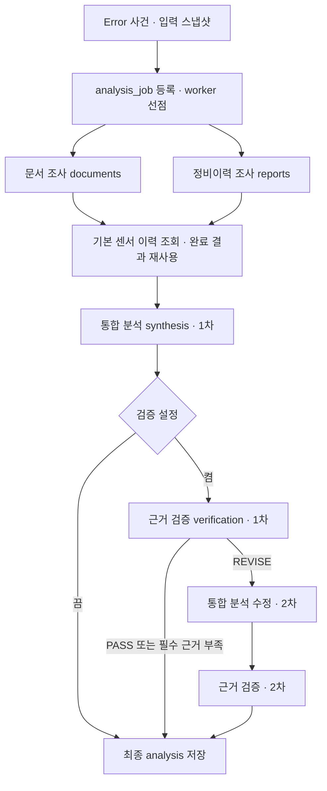

# 멀티에이전트 사건 분석 구현 가이드

현재 작업 코드의 `multi-analysis-v7` 기준 문서다. 실제 실행 환경의 설정값이나 배포 완료를
뜻하지 않는다. 기본값은 단일 분석이며 `ANALYSIS_MODE=multi`일 때 아래 흐름을 사용한다.

- 역할·프롬프트·제출 형식: [MULTI_AGENT_PROMPTS](MULTI_AGENT_PROMPTS.md)
- 공통 실행기와 단일 분석: [AGENT](AGENT.md)
- 필드 정의: [CONTRACTS](CONTRACTS.md), 센서 도구: [SENSOR_WINDOWS](SENSOR_WINDOWS.md)
- 센서 수신과 작업 등록: [AUTO_ANALYSIS](AUTO_ANALYSIS.md)

## 1. 구현 범위

공식 문서 조사와 정비이력 조사를 나누고, 그 결과를 통합한 뒤 선택적으로 독립 검증한다.
검색 원문·단계별 답변·검증 지적을 보존하며 실행 실패 시 완료한 단계를 재사용한다.

네 역할은 같은 LLM 모델·effort 설정을 사용하지만 역할별 클라이언트·작업 기억·허용 도구가
분리되어 있다. 서로 다른 모델 네 개를 학습하거나 실행하는 구조가 아니다.
LangGraph가 역할의 실행 순서·병렬 조사·수정 분기를 관리하고, 각 역할 안에서는 기존
`run_agent`가 Claude의 도구 호출과 결과 제출을 처리한다.

AI는 원인·점검 후보와 대응 정보를 제안한다. 실제 정비, 원인 확정, 설비 제어, 정지 해제,
재가동 승인, 보고서의 사람 작성 칸(`maintenance`)과 결재 칸(`approval`) 작성은 수행하지 않는다.
챗봇은 별도 실행 흐름이며 이번 사건 분석 그래프에 포함되지 않는다.

## 2. 실행 흐름



1. 자동 분석을 켠 경우 최초 Error 또는 Warning→Error 전환 시 분석 작업을 등록한다.
   같은 사건의 반복 Error·회복마다 새 작업을 만들지는 않는다.
2. worker는 등록 당시의 사건 스냅샷을 사용한다. 분석 중에도 센서 수신·탐지는 계속된다.
3. 문서 조사와 정비이력 조사는 병렬 실행한다. 공유 검색기의 호출은 잠금으로 직렬화한다.
4. 두 조사가 끝나면 서버가 기본 센서 이력을 조회하고 통합 분석을 실행한다.
5. 검증을 켰으면 원문·사건·센서 통계와 주장을 대조한다. 수정과 재검증은 최대 한 번이다.
6. 종료 결과를 `analysis`에 저장하고 `analysis_job.analysis_id`로 연결한다.

조사 결과 0건은 정상이다. 조사 도구·LLM의 실행 실패를 근거 없음으로 취급하지 않는다.
조사가 실패하면 통합을 생략하고 실패로 종료한다. 검증 시스템이 실패해도 검증을 자동으로
생략해 성공으로 바꾸지 않는다. 그래프의 실패 처리 세부는 8절을 따른다.

## 3. 네 역할의 입력과 출력

| 역할 | 입력 | 허용 도구 | 공개 결과 |
|---|---|---|---|
| 문서 조사 `documents` | 사건·설비·코드·판정 센서값·출처 선언 | `search_evidence`, `submit_research` | 적용 기준·핵심 점검·안전 조건, 조사 한계, 근거 원문 |
| 정비이력 조사 `reports` | 같은 사건 정보 | `search_evidence`, `submit_research` | 비교 결론, 대표 사례 최대 2건, 한계, 보고서 원문 |
| 통합 분석 `synthesis` | 사건, 두 조사 결과와 원문, 센서 조회 결과, 수정 시 이전 분석·검증 지적 | `get_sensor_window`(조회기 주입 시), `submit_analysis` | 원인 후보·점검·권고·승인 필요 조치·추가 확인·참고 사례·한계 |
| 근거 검증 `verification` | 사건, 통합 결과, 두 조사의 전체 확보 원문, 센서 조회 결과 | `get_sensor_window`(조회기 주입 시), `submit_verification` | PASS/CAUTION/REVISE/INSUFFICIENT_EVIDENCE, 요약, 문제 주장·이유·확인 또는 수정 요청. CAUTION은 경미한 주의사항만 남은 경우로 재수정 없이 결과와 함께 표시한다 |

통합·검증 역할은 문서 검색 도구를 갖지 않는다. 조사 단계에서 확보한 실제 원문을 전달받아
판단하며, 서로의 내부 대화나 추론 전체를 주고받지 않는다.
검증 PASS 뒤에 별도의 최종 답변 에이전트는 없다. 통과한 통합 결과가 최종 결과가 된다.

## 4. 검색 범위와 대표 정비 사례

### 서버에서 제한하는 검색 범위

| 자료 | 검색 대상 |
|---|---|
| 공식 문서 | 현재 등록·색인 완료(`completed`)·승인(`approved`)된 manual/sop/rule 중 동일 설비 ID의 자료 |
| 정비이력 | 동일 설비·공정, 사건 에러코드 중 하나 이상 일치, 사람 작성 정비 내용이 있는 최신 승인 보고서 판본 |

정비이력은 허용 보고서 ID·승인 판본을 확인하고 벡터 검색에도 에러코드 OR 필터를 적용한다.
다른 코드의 보고서나 다른 설비로 자동 확대하지 않는다. 공식 문서는 에러코드 필터를
강제하지 않아 같은 설비에 적용되는 공통 안전 절차도 검색할 수 있다.

조사 에이전트는 검색어를 바꿔 추가 검색할 수 있다. 검색 한 번의 반환 건수는 기본 5개,
요청 가능한 범위는 1~8개이며 역할별 보존 근거는 최대 24개다. 검색된 원문을 전부 최종
화면에 나열하지 않고 다음 단계에서 필요한 발견으로 요약한다.

### 대표 사례 선별

정비이력 조사는 현재 사건과 증상·운전 조건이 비슷하고 실제 조치·결과가 구체적인 보고서를
최대 2건 선별한다. 최신 날짜나 검색 점수만으로 고르지 않고 같은 원인·조치·결과의 반복은
대표 한 건으로 정리하도록 지시한다. 서로 다른 유용한 조치나 결과가 있을 때 두 번째를 남긴다.

각 `reference_cases` 항목은 다음을 보존한다.

| 필드 | 내용 |
|---|---|
| `symptom` | 당시 증상 |
| `action` | 실제 수행한 조치 |
| `outcome` | 기록된 조치 결과 |
| `similarity` | 현재 사건과의 유사점 |
| `differences` | 차이점과 적용 한계 |
| `evidence_ids` | 같은 보고서 판본의 실제 확보 근거 |

문장 필드는 각각 최대 400자다. 테스트 문구뿐인 보고서, 조치·결과를 확인할 수 없는 사례는
개수를 채우기 위해 넣지 않는다. 기록되지 않은 조건은 미기록으로 설명하고 추측하지 않는다.
적합한 이력이 없어도 공식 문서가 점검 안내를 뒷받침하면 분석은 OK/PASS가 될 수 있다.

통합 에이전트는 조사에서 선별한 사례의 위치를 `reference_case_indices`로 선택한다.
서버는 해당 사례 요약을 그대로 복사하고 출처를 최종 결과에 유지한다. 통합 모델이 보고서
번호나 사례 문구를 새로 생성하지 않는다. 검증 지적 후 수정 분석에서 부적합 사례를 제외할 수 있다.

최대 2건, 같은 보고서 중복, 알려지지 않은 근거, 여러 판본을 섞은 사례와 잘못된 선택 위치는
서버가 검사한다. 내용상 중복 판별·유사성·요약 정확성은 프롬프트와 검증 모델에 의존하므로
실제 데이터 평가가 필요하다.

### 공식 절차와 과거 조치가 충돌할 때

예를 들어 과거 보고서에 “알람 해제 후 바로 재가동”이 기록되어도 공식 SOP가 점검·승인을
요구하면 현재 권고는 SOP를 따른다. 과거에 수행한 조치를 참고 사례로 소개할 수는 있지만
현재 실행 지시와 구분하고 적용 한계·필요한 승인 조건을 명시한다.

새 통합·검증 제출에서는 문서 버전·해시와 보고서 승인 판본 등 출처의 현재 유효성을 확인한다.
다만 완료 단계 재사용에서는 당시 원문 스냅샷을 유지한다. 이 차이는 9절을 따른다.

## 5. 기본 센서 조회와 수치 보호

통합 분석의 첫 LLM 호출 전에 서버가 기존 `get_sensor_window` 함수를 실행한다.
이는 추가 에이전트나 LLM 호출이 아니다. 웹 API가 `SensorReader`를 주입한다.
직접 호출·테스트에서 조회기를 생략하면 사건 스냅샷만 쓰는 호환 동작을 유지한다.

- 기준 시각: 입력 사건의 `last_detected_at`.
- 기본 요청 범위: 그 시각 이전 120초부터 기준 시각까지. 이후 데이터는 기다리지 않는다.
- 항목: 사건 판정 필드를 우선하고 코드별 센서군을 추가해 최대 10개 선택한다.
  이송은 입출구·회전수, M09/M10은 온도·전류·회전수·양측 진동 RMS,
  M11 이상은 진동·첨도·회전수·온도, 다른 모터 코드는 회전수·전류·전압을 기본으로 한다.
- 이미 저장된 표본만 사용한다. 120초 요청은 120초 송신 완료를 기다린다는 뜻이 아니다.
  12초만 관측됐다면 나머지 미관측 구간을 알리고 보간하거나 정상값으로 채우지 않는다.
- 성공한 0건 조회도 `purpose=baseline`으로 기록한다. 2차 분석·재시도에서 이를 재사용한다.
- 조회 장애는 통합 단계 실패다. 정상적인 표본 없음과 구분한다.
- 통합·검증 에이전트는 필요하면 같은 도구로 추가 조회할 수 있다.

모델이 사용하려는 통계는 `sensor_claims`로 제출하고 실제 반환값과 대조한다. 후보의
`sensor_claim_indices`는 그 검증 수치의 위치를 가리킨다. 서버가 후보별 `observations`를
작성하며, `basis`는 후보와 문서 사이의 연결 설명으로 유지한다. 공통 사건·기본 센서 정보는
서버가 작성해 후보마다 같은 문장이 반복되지 않게 한다.

`quality`에는 요청 범위·실제 반환 범위·앞뒤 미관측 구간·표본 간 공백·출처별 건수·선언된
주기를 보존한다. `max_gap_seconds`는 반환된 표본 사이의 최대 간격이며 요청 구간 전체의
연속성을 의미하지 않는다. 주기가 하나로 일치할 때만 주기의 1.5배 초과 간격을 공백으로 표시한다.
표본 상한 때문에 반환하지 못한 범위는 원래 DB에도 표본이 없었다고 단정하지 않는다.

`SIMULATION/REPLAY/MEASURED/UNKNOWN`은 송신자 선언 또는 출처 미확인 상태다.
MEASURED도 독립적인 실측 인증이 아니다. 일정한 값이나 문서 지정값과 숫자가 같다는 이유로
실측·대체값을 단정하지 않는다. 현재 고온 시연만으로 실제 냉각·부하·마찰 원인을 확정할 수 없다.

## 6. 프롬프트와 출력 길이

프롬프트는 코드에서 역할 지시문·공통 평가 기준·센서 규칙·요약 기준을 조합한다.
현재 단계 버전은 `multi-analysis-v7-documents`, `-reports`, `-synthesis`, `-verification`이다.
최종 `AnalysisResult.prompt_version`은 `multi-analysis-v7`다.

조사 발견은 최대 5개(각 400자), 한계는 최대 3개(각 300자)로 제출을 제한한다.
통합은 후보 1~3개·점검 3~5개, 짧은 설명과 중복 통합을 목표로 한다. 검증 요약은 1~2문장을
요청한다. 통합·검증의 길이는 프롬프트 목표이며 필요한 안전·승인 조건을 개수 때문에 자르지 않는다.

새 원인 후보는 발생 가능성 등급 대신 `inspection_priority`(우선 확인/후속 확인)와
`priority_reason`(점검 순서의 근거)을 제출한다. 현재 현장 점검 결과 없이도 공식 절차와
사건 코드·증상, 과거 사례의 관련성으로 순서를 제안한다. 안전상 선행 조건은 언제나 우선한다.
이전 likelihood는 저장 호환용으로만 남기며 화면에서 우선순위로 재해석하지 않는다.
검증은 사실·인용 의미·적용 조건·안전 위반을 검사하며 문체 취향이나 적절하게 명시한
자료 부재만으로 반려하지 않도록 지시한다.

실제 지시 구성과 제출 형식은 [MULTI_AGENT_PROMPTS](MULTI_AGENT_PROMPTS.md)를 참고한다.

## 7. PostgreSQL 저장 구조

| 테이블 | 주요 컬럼 | 용도 |
|---|---|---|
| `analysis_job` | `job_id`, `incident_id`, `status`, `snapshot`, `analysis_id`, `error_code` | 전체 실행과 입력 사건 스냅샷, 최종 결과 연결 |
| `analysis_agent_run` | `job_id`, `role`, `attempt`, `data`, `updated_at` | 역할·차수별 공개 결과 |
| `analysis_checkpoint` | `job_id`, `data`, `updated_at` | 역할 경계에서 재개할 입력 |
| `analysis` | `id`, `incident_id`, `status`, `model`, `prompt_version`, `generated_at`, `data` | 최종 분석 결과 |

PostgreSQL에서 `data`는 JSONB다. 네 역할별 별도 테이블을 만들지 않고
`analysis_agent_run`의 복합 기본키 `(job_id, role, attempt)`로 구분한다.

| 역할 | 답변이 들어가는 JSON 경로 |
|---|---|
| `documents` | `data.research.findings`, `data.research.limitations` |
| `reports` | 위 조사 필드와 `data.research.reference_cases` |
| `synthesis` | `data.analysis` |
| `verification` | `data.verification.verdict/summary/issues` |

공통으로 `data.evidence`, `data.sensor_windows`, 상태·시각·소요 시간·모델·프롬프트 버전·
호출 수·입출력 토큰·오류 종류·재사용 원본 작업 ID를 남긴다. 사용량을 받지 못하면 null이다.
PENDING→RUNNING→종료 과정에서 같은 행을 갱신하며 종료된 단계 결과는 임의로 덮어쓰지 않는다.
1차 정상 흐름은 네 역할 행, 수정과 2차 검증까지 가면 최대 여섯 역할/차수 행으로 남는다.
검증을 끈 경우도 verification의 SKIPPED 기록을 남긴다.

단계 결과와 체크포인트는 같은 DB 트랜잭션으로 저장한다. `analysis`의 최종 결과 저장과
`analysis_job` 종료 처리도 같은 트랜잭션이다. 프롬프트 전문·전체 대화·thinking·원시 센서 행은
단계 DB/API에 저장하지 않는다. 체크포인트에도 공개 결과·근거 원문·센서 요약·검증 설정을
보존하며 전체 대화를 저장하지 않는다. Langfuse 본문 기록 여부는 별도의 기존 설정을 따른다.

단계별 답변은 검색용 벡터DB에 자동 등록되지 않는다. 기존 문서 등록과 최종 승인된
사람 작성 보고서 색인은 별도 경로다. 멀티 도입만으로 Qdrant 서버·컬렉션을 나누거나
기존 자료를 재임베딩할 필요는 없다. 임베딩 모델 변경에 따른 재색인은 별개다.

디비버 등에서 아래 읽기 전용 쿼리로 최근 단계 결과를 확인할 수 있다.

```sql
SELECT j.incident_id, r.job_id, r.role, r.attempt,
       r.data ->> 'status' AS stage_status,
       r.data ->> 'prompt_version' AS prompt_version,
       r.data -> 'research' AS research,
       r.data -> 'analysis' AS synthesis,
       r.data -> 'verification' AS verification
FROM analysis_agent_run r
JOIN analysis_job j ON j.job_id = r.job_id
ORDER BY j.created_at DESC, r.attempt, r.role
LIMIT 50;
```

실제 사건 연결은 내부 `incident_id`를 사용한다. 화면의 읽기 쉬운 `incident_number`와 구분한다.

## 8. 작업 상태·분석 상태·검증 판정

이 세 상태를 혼동하지 않는다.

| 구분 | 값 | 의미 |
|---|---|---|
| 작업/단계 상태 | `PENDING`, `RUNNING` | 대기·실행 중 |
| 단계 상태 | `COMPLETED` | 해당 역할이 결과 제출을 완료함. 검증 통과라는 뜻은 아님 |
| 단계 상태 | `SKIPPED` | 설정 또는 선행 실패로 생략. PASS가 아님 |
| 작업/단계 상태 | `FAILED` | 실행 장애·중단 |
| 최종 분석 | `OK` | 근거 기반 안내 생성. 원인 확정·안전 인증을 의미하지 않음 |
| 최종 분석 | `INSUFFICIENT_EVIDENCE` | 안내에 필요한 근거 부족 |
| 최종 분석 | `VERIFICATION_FAILED` | 2차 검증도 REVISE. 검증 미통과 초안 보존 |
| 최종 분석 | `FAILED` | 도구·LLM 등 실행 실패 |
| 검증 판정 | `PASS`, `REVISE`, `INSUFFICIENT_EVIDENCE` | 통과·수정 필요·필수 근거 부족 |

최종 분석이 FAILED인 경우 작업도 FAILED다. OK·INSUFFICIENT_EVIDENCE·
VERIFICATION_FAILED는 작업 COMPLETED다. 따라서 “분석 완료” 표시와 “검증 미통과”가
동시에 나올 수 있다. 실행이 끝났다는 뜻과 내용이 통과했다는 뜻이 다르기 때문이다.

## 9. 실패 단계부터 수동 재시도

현장 점검자·보전 팀장·관제 담당자가 실행 실패 작업을 재시도할 수 있다.
정상적인 근거 부족·검증 반려 판정을 다시 돌려 통과시키는 기능은 아니다.
사건에 최종 승인된 보고서가 있으면 새 요청을 409로 거절하고 화면에서도 버튼을 숨긴다.
예약 뒤 worker 선점 전에 승인된 경우에도 새 모델 호출 없이 예약을 종료한다.

| 실패 지점 | 다시 실행하는 부분 | 재사용 |
|---|---|---|
| 문서 조사 | 문서 조사 → 통합 → 선택 검증 | 성공한 이력 조사 |
| 정비이력 조사 | 이력 조사 → 통합 → 선택 검증 | 성공한 문서 조사 |
| 통합 분석 | 실패한 차수 통합 → 선택 검증 | 두 조사와 완료된 센서 조회 |
| 1차 검증 | 1차 검증, 필요하면 수정·2차 검증 | 조사·1차 통합 |
| 2차 통합 | 2차 통합 → 2차 검증 | 조사·1차 통합/검증 |
| 2차 검증 | 2차 검증만 | 수정 통합까지 완료 결과 |

새 `analysis_job`을 만들고 완료 단계에는 `reused_from_job_id`를 표시한다. 원래 실패 기록을
유지하며 재사용 단계의 소요 시간·토큰은 이전 실행 통계로 보여준다. 새 수동 재시도에는
전체 시간·호출 예산을 새로 부여하지만 수정 허용 횟수는 초기화하지 않는다.

실패한 역할의 도구 루프는 처음부터 실행한다. 도구 호출 한 개나 LLM 대화 중간부터 이어가는
기능은 아니다. 완료한 기본 조회는 0건도 재사용하며 조회 자체가 실패한 경우 다시 조회한다.
원래 사건 스냅샷과 완료 단계의 근거를 유지하고 새 검색 결과로 교체하지 않는다.
문서 삭제·개정에 따른 완료 조사 무효화나 전체 재분석은 현재 범위에 없다.

서버 재시작 시 진행 작업은 interrupted 실패로 닫고 사용자가 재시도해야 한다.
이 구현은 LangGraph 역할 경계에 결과를 재주입하는 애플리케이션 체크포인트이며
LangGraph native checkpointer·interrupt/resume·임의 단계 이동을 사용하지 않는다.
모델 응답 후 DB 저장 전에 프로세스가 종료되면 해당 미저장 역할은 재호출될 수 있다.
도입 전 실패 작업·단일 분석에는 체크포인트가 없어 전체 재시도로 처리한다.

## 10. 조회·재시도 API와 화면

| API | 내용 |
|---|---|
| `GET /incidents/{incident_id}/analysis` | 로그인 필요. `job`, `analysis`, 최신 작업의 `stages`, `retry_mode` 반환 |
| `POST /incidents/{incident_id}/analysis/retry` | 역할 제한·실패 작업·승인 여부 검사 후 202 예약 |

재시도 본문은 `request_id`(UUID), 선택적 `job_id`다. 같은 요청 재전송은 같은 request_id를
사용하며 추가 실행을 만들지 않는다. 오래된 job_id로 새 요청하면 409다.
조회의 retry_mode는 가능한 경우 `resume`(체크포인트 있음) 또는 `restart`, 나머지는 null이다.
새 작업 실행 중에도 이전 analysis가 있을 수 있으므로 job 상태와 함께 읽어야 한다.

`hmi/web`의 이상현황 사건 상세와 임시 사건 테스트 화면이 같은 분석 컴포넌트를 사용한다.
진행 중에는 문서 조사·정비이력 조사·통합 분석·근거 검증과 1/2차 상태를 표시한다.
기본 화면은 최종 후보·권고 점검·조치·추가 확인과 참고 사례를 보여준다. 후보 상세,
공통 사건·센서 정보와 분석 한계는 펼쳐 볼 수 있다.

**분석 과정 및 근거 보기**는 기본 접힘이며 네 탭에 역할별 결과·원문·센서 조회 범위·검증
지적·실행 통계를 표시한다. 통합 탭은 초안이며 최종 상태는 상단 결과에서 확인한다.
“확보한 근거 원문”은 단계별 입력 목록이다. 통합·검증에는 두 조사 원문을 함께 넘기므로
같은 원문이 반복될 수 있다. 통합에서는 실제 인용한 근거와 전달된 참고 근거를 구분한다.

최종 참고 사례는 최대 2건이며 적합한 사례가 없으면 영역을 숨긴다. 이상현황의
**보고서 확인**은 해당 출처 보고서 판본을 연다. 새 사례 전용 영역은 사건 분석 화면에 적용된다.
문서 출처는 문서명·버전·PDF 실제 쪽수·절로 표시하고 긴 근거 ID는 별도 펼침에 둔다.
과거 자료에 페이지가 없으면 청크 순번으로 추정하지 않는다.

사건 클릭과 **새로고침**은 저장된 상태·결과 조회이며 LLM 재분석이 아니다.
진행 중에는 상태를 주기적으로 조회한다. OK 분석의 기존 AI 제안은 보고서 초안에 연결된다.
보고서 화면에서는 항목별 출처와 긴 limitations 문단을 숨기고, **참조 매뉴얼·이력**에
문서명·버전·페이지를 유지한다. 그 칸의 근거 식별 정보도 숨긴다. 저장된 근거 데이터는 보존한다.
VERIFICATION_FAILED 초안을 검증된 보고서 AI 제안으로 표시하지 않는다.

## 11. 설정·실행·검증

다음은 코드 기본값이다. 실제 실행 환경을 읽거나 확인한 값이 아니다.

| 설정 | 기본값 | 의미 |
|---|---|---|
| `ANALYSIS_AUTO_ENABLED` | false | true일 때 Error 자동 분석과 DB 저장 |
| `ANALYSIS_MODE` | single | multi일 때 이 문서의 그래프 사용 |
| `ANALYSIS_VERIFICATION_ENABLED` | false | multi의 독립 검증·최대 1회 수정 |
| `ANALYSIS_TOTAL_TIMEOUT_S` | 180 | 멀티 실행 전체 시간 예산(초) |
| `ANALYSIS_MAX_CALLS` | 24 | 멀티 전체 Claude 요청 상한. SDK 재시도도 포함 |
| `AGENT_MAX_TURNS` | 8 | 역할 한 번의 도구 루프 상한 |
| `TELEMETRY_DB_ENABLED` | false | 자동 분석이 꺼져 있을 때 DB 저장만 별도로 켜는 설정 |

사용자가 실행 환경에 적용할 멀티+검증 예시는 다음과 같다. 키는 포함하지 않는다.

```ini
ANALYSIS_AUTO_ENABLED=true
ANALYSIS_MODE=multi
ANALYSIS_VERIFICATION_ENABLED=true
ANALYSIS_TOTAL_TIMEOUT_S=180
ANALYSIS_MAX_CALLS=24
AGENT_MAX_TURNS=8
```

의존성은 `uv sync --locked --no-install-project`, DB는 `make db-migrate`로 현재 head까지
적용한다. 관련 이력은 0010 단계 기록, 0011 체크포인트, 0012 센서 출처, 0013 사건번호다.
참고 사례는 기존 JSON 안에 저장하므로 별도의 마이그레이션이 없다. 설정 변경 후 API를
재시작하고 새 사건으로 확인한다. 기존 분석이 자동 갱신되지는 않는다.

역할 수와 LLM 호출 수는 다르다. 예를 들어 두 조사가 각각 검색 요청·결과 제출로 2번,
통합 1번, 검증 1번이면 총 6번이며 수정·재검증이 각각 1번이면 8번이다. 추가 검색·조회,
제출 수정·SDK 재시도로 늘 수 있다. 기본 센서 조회는 LLM 요청을 추가하지 않는다.
검증을 끄면 세 역할, 켜면 네 역할이며 각 역할마다 별도 전체 예산을 주는 구조는 아니다.
전체 예산은 실행 중인 로컬 연산·DB 작업을 강제 취소하는 제한이나 청구액 상한은 아니다.

자동 검증은 실제 키·환경 파일·운영 DB·유료 API 대신 가짜 클라이언트와 임시 DB를 사용한다.

```bash
uv run --no-sync pytest tests/agent/test_multi_analysis.py tests/contracts/test_analysis_workflow.py tests/contracts/test_incident_analysis.py
make check
```

대표 검증 범위는 병렬 조사, 출처 보존, 검증 분기·수정 한도, 점검 우선순위 및 과거 등급 호환,
기본 센서 조회·공백·수치 대조·재사용, 단계 저장·재시도·승인 후 차단,
사례 건수·선택 위치·원문 요약 보존·사례 전용 출처 보존이다.
실제 LLM의 관련 사례 선별·중복 판단·요약 정확성·지연·비용은 별도 실행 평가 대상이다.
`make analyze`와 무료 센서 데모는 단일 분석 기준선이며 이 멀티 흐름의 실행 명령이 아니다.
실제 인증 확인과 유료 실행은 사용자가 자기 터미널에서 수행한다.

## 12. 코드 위치와 남은 범위

| 파일 | 책임 |
|---|---|
| `src/weeing_weeing/agent/multi_analysis.py` | LangGraph 구성, 역할 실행, 공유 예산, 수정 분기·체크포인트 재사용 |
| `src/weeing_weeing/agent/runtime.py` | 역할별 도구 루프·작업 기억·구조화 제출 |
| `src/weeing_weeing/agent/analyst.py` | 공통 분석·평가·센서 규칙, 제출 검사 |
| `src/weeing_weeing/agent/analysis_briefs.py` | 요약·사례 선별·검증 출력 기준과 제출 모델 |
| `src/weeing_weeing/agent/baseline_sensors.py` | 기본 센서군·조회·공통 관측 작성 |
| `src/weeing_weeing/api/analysis_knowledge.py` | 설비·공정·코드·승인 기반 검색 정책 |
| `src/weeing_weeing/api/analysis.py` | worker 조립, 단계 저장 콜백, 조회·재시도 API |
| `src/weeing_weeing/db/analysis_jobs.py`, `models.py` | 작업·단계·최종 결과·체크포인트 저장 |
| `src/weeing_weeing/contracts/analysis.py`, `analysis_workflow.py` | 공개 결과와 재개 입력 계약 |
| `hmi/web/src/pages/IncidentTestPage.jsx`, `IncidentHistoryPage.jsx` | 공통 최종 결과·사건 상세 연결 |
| `hmi/web/src/components/AnalysisStages.jsx`, `AnalysisProgress.jsx`, `AnalysisRetry.jsx` | 단계 기록·진행 상태·재시도 |
| `hmi/web/src/components/MaintenanceReferences.jsx` | 대표 사례·출처 보고서 열기 |

사람 확인을 기다리는 그래프 중단/재개, 성공 사건 전체 재분석 UI, 문서 변경에 따른 조사
무효화, 역할별 모델 설정, 실행 간 검색 질의 캐시·대화 압축, 자동 유료 재시작은 구현하지 않았다.
원인별 센서 시뮬레이션 보강과 실제 분석 성능·비용 비교도 별도 작업이다.
