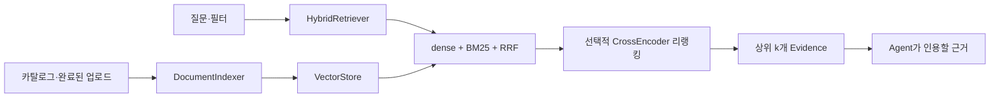

# 검색·리랭킹 구현과 연결

기준: [README](../README.md), [ARCHITECTURE](ARCHITECTURE.md),
[DECISIONS](DECISIONS.md)의 D-12·D-19·D-20, [CONTRACTS](CONTRACTS.md).
검색 담당 범위는 저장소의 하이브리드 검색 결과를 재정렬하고 `Evidence`로 제공하는 부분이다.

## 폴더별 역할

| 폴더 | 책임과 검색 연결 지점 |
|---|---|
| `src/weeing_weeing/contracts/` | Evidence·Incident·분석·문서 계약. 이번 구현에서 필드는 변경하지 않는다 |
| `src/weeing_weeing/ingest/` | 센서 입력 검증·재생 |
| `src/weeing_weeing/detector/` | 센서 룰 판정과 Incident 생성. 검색어에 활용할 사건 정보를 만든다 |
| `src/weeing_weeing/rag/` | 문서 파싱·색인·저장소·검색·리랭킹. 외부 진입점은 `interface.py`다 |
| `src/weeing_weeing/agent/` | 검색 근거로 원인·점검을 제안할 영역. 현재 Analyzer·LlmClient 인터페이스 단계다 |
| `src/weeing_weeing/api/` | 모듈 조립과 HTTP API. 현재 문서 업로드 API가 있으며 검색·진단 API는 별도 작업이다 |
| `src/weeing_weeing/db/` | 문서 레지스트리와 상태 관리. rag는 DB 구현을 import하지 않는다 |
| `src/weeing_weeing/plc/` | 독립 보호 제어. rag를 import하지 않는다 |
| `src/weeing_weeing/scripts/` | 기존 청크 미리보기·색인 보조 코드 |
| `data/manuals/`, `rulebase/`, `regulations/` | 매뉴얼·룰 정의서·SOP 원본. `data/catalog.toml`이 기준 목록이다 |
| `data/parsed/`, `chunked/` | 파싱 결과·청크 검토용 Markdown. 현재 색인 원본은 카탈로그에 적힌 PDF다 |
| `data/eval/` | 검색 평가 질의. 현재 정답은 기대 문서와 본문 키워드로 판정한다 |
| `data/telemetry/` | 센서 CSV와 시연 그래프 |
| `data/templates/`, `report/` | 보고서 양식. 승인 보고서의 사람 작성 칸 색인은 별도 기능이다 |
| `scripts/` | 색인·E2E·시연 실행 진입점. 재사용 로직은 src에 둔다 |
| `tests/` | contracts·각 모듈·실행 스크립트 검증 |
| `docs/` | 구조·계약·결정·검증 기록. `prompts/`는 작업 지침, `rag_e2e/`는 기존 측정 기록이다 |
| `frontend/`, `hmi/web/` | React 화면. HTTP API를 통해 연결한다 |
| `simulator/` | Unreal 연동 규격. 센서 수집·PLC 경로에 연결된다 |
| `.github/` | CI, 이슈·PR 양식 |
| `.agents/skills/`, `.claude/skills/` | 팀 스킬 원본과 자동 복사본 |
| `.git/`, `.venv/`, `.pytest_cache/`, `.ruff_cache/` | 버전 관리·실행 환경·도구 캐시 |

프로젝트 MD는 설계·규칙 파악에 사용한다. 전체 저장소를 자동 색인하지 않는다.
`storage/`·`outputs/`는 실행 시 생기는 저장소·업로드·검증 결과 경로다.

## 흐름과 구현 위치



| 파일 | 역할 |
|---|---|
| `rag/store.py`, `qdrant_store.py`, `chroma_store.py`, `sparse.py` | 기존 dense·BM25·RRF 구현. D-12에 따라 저장 계층에서 끝낸다 |
| `rag/reranker.py` | 내부 Reranker Protocol과 로컬 CrossEncoderReranker. 질문·청크 본문 쌍을 채점한다 |
| `rag/retriever.py` | 입력 검증 → 필터 변환 → 후보 검색 → 리랭킹 → 상위 k개 선택 → Evidence·인용 생성 |
| `rag/factory.py` | 설정으로 검색기를 조립한다. 주입받은 저장소의 종료는 호출자가 담당한다 |
| `rag/interface.py` | 외부용 Retriever.search와 get_retriever. API 색인·검색은 프로세스 안에서 저장소 하나를 공유한다 |
| `rag/registry.py` | DB에서 받은 DocumentRecord를 색인 목록으로 변환. 검색 순위를 계산하지 않는다 |
| `rag/e2e.py`, `scripts/verify_rag_e2e.py` | dense·hybrid와 공개 검색기의 reranked 결과를 비교한다 |

## 후보·점수·실패 규칙

- `k`는 최종 반환 개수다. 리랭킹을 켜면 `max(k, RAG_CANDIDATE_K)`개를 저장소에서 받는다.
  저장소 내부 dense·BM25 prefetch는 기존처럼 이 후보 수의 4배다.
- 리랭킹을 끄면 기존대로 저장소에 `k`를 전달한다. 후보 수 기본값 30은 조정 시작값이다.
- 필터는 후보 검색 전에 적용한다. `code`는 `codes` 별칭이며 두 키를 함께 쓰면 오류다.
- 리랭커는 원래 Hit 객체를 재배열한다. ID·버전·본문·출처·RRF 점수는 보존한다.
- 반환 목록의 순서가 최종 관련도다. `Evidence.score`는 원래 RRF 점수이므로 다시 score로 정렬하지 않는다.
  모델 점수와 RRF 점수를 합산하거나, RRF 점수를 확률·근거 충분성 임계값으로 사용하지 않는다.
- 동점이면 입력 순서를 유지한다. 점수 개수 불일치·NaN·무한대는 오류다.
- 빈 검색 결과는 `[]`다. 검색·모델 로드·추론 실패는 예외로 전달한다. 실패를 근거 없음으로 바꾸거나 조용히 RRF로 대체하지 않는다.
- Agent는 근거가 없으면 `INSUFFICIENT_EVIDENCE`로 멈춘다. 검색 결과가 있다는 사실만으로 근거가 충분하다고 판단하지 않는다.

## 설정과 외부 모듈 연결

`.env.example`의 `RERANKER_MODEL`이 비어 있으면 리랭킹을 끈다. 사용할 때는 미리 준비한
단일 관련도 점수 출력 CrossEncoder의 로컬 디렉터리 또는 캐시된 모델 ID를 지정한다.
실제 모델 선정·한국어 설비 질의 품질 평가는 별도로 필요하다.

```dotenv
RERANKER_MODEL=C:/models/selected-reranker
RAG_CANDIDATE_K=30
```

후보가 있는 첫 검색에서 모델을 한 번 올려 재사용한다. 추론 중 다운로드하지 않도록
`local_files_only=True`, `trust_remote_code=False`로 로드한다.
API 인자는 [Sentence Transformers 공식 문서](https://www.sbert.net/docs/package_reference/cross_encoder/model.html)를 따른다.
모델 파일이 준비되지 않으면 오류로 알린다. 새 의존성은 추가하지 않는다.

API 또는 실행 스크립트에서 공개 인터페이스로 검색기를 조립한 뒤 Agent에 주입한다.

```python
from weeing_weeing.rag.interface import Retriever, get_retriever

retriever: Retriever = get_retriever()
evidence = retriever.search(
    "입구 센서 장기 점유 시 점검 방법",
    k=5,
    filters={"code": "BTT2-P03", "status": "approved"},
)
```

`get_retriever()`와 `get_indexer()`는 같은 저장소를 재사용한다. 매 요청마다 모델·저장소를
만들거나 공유 저장소를 닫지 않는다. 설정은 시작 전에 지정하고 변경 시 프로세스를 재시작한다.
위 예시의 승인 필터는 호출자가 선택하는 정책이다. 초안 포함 여부는 명시적으로 결정한다.
Agent 구현·HTTP 검색 API·화면 연결은 이번 검색 담당 구현 범위에 포함하지 않는다.

## 검증과 품질 평가

```bash
uv run --no-sync pytest tests/rag/test_reranker.py tests/rag/test_retriever.py tests/rag/test_factory.py tests/rag/test_e2e.py tests/test_config.py
make check
```

모델 없는 자동 검증은 가짜 채점기로 후보 확장, 재정렬, 필터, 인용·점수 보존,
실패 전파, 저장소 공유와 Qdrant·Chroma 연결을 확인한다. 실제 모델 품질을 증명하지는 않는다.

임베딩 모델과 리랭커를 준비한 뒤 실제 문서 비교를 실행한다.

```bash
make rag-e2e
# Windows에서 make가 없을 때: PowerShell에서 $env:PYTHONPATH = "src" 지정 후
uv run --no-sync --env-file .env python scripts/verify_rag_e2e.py
```

`RERANKER_MODEL`이 있으면 dense·hybrid·reranked의 hit@1·hit@k·MRR과 개별 순위를
Markdown 보고서로 남긴다. 없으면 기존 두 방식만 평가한다. 모델 하나를 모든 백엔드에서 재사용한다.
리랭커 실패도 종료 코드 2와 보고서로 알린다.

현재 12개 샘플의 문서·키워드 판정은 정답 청크 단위 평가보다 느슨하다.
정답 청크·오답·근거 없는 질의를 보강하고 후보 수·최종 k·모델별 품질과 처리 시간을 비교한 후
운영 설정을 결정한다. 과거 E2E 수치를 새 리랭킹 성능으로 해석하지 않는다.

## 2026-10-27 구현 검증 기록

- 검색·리랭킹·factory·E2E·Chroma·설정 관련 테스트: 130개 통과(가짜 모델 사용).
- 전체 pytest 최종 실행: 656개 통과, 9개 실패, 4개 건너뜀.
- 남은 실패는 이번에 수정하지 않은 코드의 Windows 호환성 문제다.
  `tests/db/test_document_repository.py`의 SQLite 경로 URL 표기 비교 1개,
  `tests/rag/test_catalog_sync.py`의 기본 인코딩으로 작성한 파일을 UTF-8로 읽는 검사 8개다.
- Ruff 검사·포맷 검사와 `git diff --check`를 실행했다.
- 스킬 동기화 검사는 작업 전부터 있던 `.claude/skills/README.md` 불일치로 실패한다.
  검색 범위 밖의 스킬 파일은 변경하지 않았다.
- 실제 리랭커 모델을 지정·다운로드하지 않아 실제 모델의 검색 품질은 측정하지 않았다.
- Windows에 make가 없어 `make check` 구성 명령을 개별 실행했다.

## 2026-10-27 실제 모델 측정과 Incident 질의 (#8 후속)

- `RERANKER_MODEL=BAAI/bge-reranker-v2-m3`로 실제 문서를 쟀다: hybrid MRR 0.773 → reranked **0.917**, hit@1 11 → 15/18(Qdrant·Chroma 같음). 자세한 내용은 [RAG_E2E](RAG_E2E.md) ②.
- Incident → 질의문은 `interface.incident_query(incident)`(`rag/query.py`)가 만든다. 형식과 근거(질의문 형태별 실측)는 `rag/query.py` 주석과 DECISIONS D-22.
- 평가 질의 파일은 문장(`query`) 대신 Incident 코드(`codes`)로도 쓸 수 있다(`data/eval/rag_queries_v1.toml`의 i01~i06).
- Incident로 검색할 때는 `retriever.search(incident_query(incident), k=5)`처럼 코드 필터 없이 쓰는 것을 기본으로 한다. `filters={"code": ...}`를 걸면 코드가 없는 SOP 절차 조각(정지·격리·재가동)이 빠진다(D-22). 위 예시의 코드 필터는 코드 관련 조각만 볼 때의 선택 사항이다.
