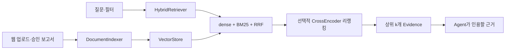

# 검색·리랭킹 구현과 연결

기준: [README](../README.md), [ARCHITECTURE](ARCHITECTURE.md),
[DECISIONS](DECISIONS.md)의 D-12·D-19·D-20, [CONTRACTS](CONTRACTS.md).
검색 담당 범위는 저장소의 하이브리드 검색 결과를 재정렬하고 `Evidence`로 제공하는 부분이다.

## 폴더별 역할

| 폴더 | 책임과 검색 연결 지점 |
|---|---|
| `src/weeing_weeing/contracts/` | Evidence·Incident·분석·문서 계약. 이번 구현에서 필드는 변경하지 않는다 |
| `src/weeing_weeing/ingest/` | 센서 입력 검증·재생 |
| `src/weeing_weeing/detector/` | 센서 룰 판정과 Incident 생성. 검색어에 활용할 사건 정보를 만든다 |
| `src/weeing_weeing/rag/` | 문서 파싱·색인·저장소·검색·리랭킹. 외부 진입점은 `interface.py`다 |
| `src/weeing_weeing/agent/` | 검색 근거로 원인·점검을 제안할 영역. 현재 Analyzer·LlmClient 인터페이스 단계다 |
| `src/weeing_weeing/api/` | 모듈 조립과 HTTP API. 현재 문서 업로드 API가 있으며 검색·진단 API는 별도 작업이다 |
| `src/weeing_weeing/db/` | 문서 레지스트리와 상태 관리. rag는 DB 구현을 import하지 않는다 |
| `src/weeing_weeing/plc/` | 독립 보호 제어. rag를 import하지 않는다 |
| `src/weeing_weeing/scripts/` | 기존 청크 미리보기·색인 보조 코드 |
| `data/manuals/`, `rulebase/`, `regulations/` | 매뉴얼·룰 정의서·SOP 원본. 운영 문서는 웹에서 등록하고 DB에서 관리한다 |
| `data/parsed/`, `chunked/` | 파싱 결과·청크 검토용 Markdown. 운영 색인 원본은 웹에 업로드한 PDF다 |
| `data/eval/` | 검색 평가 질의. 현재 정답은 기대 문서와 본문 키워드로 판정한다 |
| `data/telemetry/` | 센서 CSV와 시연 그래프 |
| `data/templates/`, `report/` | 보고서 양식. 승인 보고서의 사람 작성 칸 색인은 별도 기능이다 |
| `scripts/` | 색인·E2E·시연 실행 진입점. 재사용 로직은 src에 둔다 |
| `tests/` | contracts·각 모듈·실행 스크립트 검증 |
| `docs/` | 구조·계약·결정·검증 기록. `prompts/`는 작업 지침, `rag_e2e/`는 기존 측정 기록이다 |
| `frontend/`, `hmi/web/` | React 화면. HTTP API를 통해 연결한다 |
| `simulator/` | Unreal 연동 규격. 센서 수집·PLC 경로에 연결된다 |
| `.github/` | CI, 이슈·PR 양식 |
| `.agents/skills/`, `.claude/skills/` | 팀 스킬 원본과 자동 복사본 |
| `.git/`, `.venv/`, `.pytest_cache/`, `.ruff_cache/` | 버전 관리·실행 환경·도구 캐시 |

프로젝트 MD는 설계·규칙 파악에 사용한다. 전체 저장소를 자동 색인하지 않는다.
`storage/`·`outputs/`는 실행 시 생기는 저장소·업로드·검증 결과 경로다.

## 흐름과 구현 위치



| 파일 | 역할 |
|---|---|
| `rag/store.py`, `qdrant_store.py`, `chroma_store.py`, `sparse.py` | 기존 dense·BM25·RRF 구현. D-12에 따라 저장 계층에서 끝낸다 |
| `rag/reranker.py` | 내부 Reranker Protocol과 로컬 CrossEncoderReranker. 질문·청크 본문 쌍을 채점하고 Hit.relevance로 전달한다 |
| `rag/retriever.py` | 입력 검증 → 필터 변환 → 후보 검색 → 리랭킹 → 상위 k개 선택 → Evidence·인용 생성 |
| `rag/factory.py` | 설정으로 검색기를 조립한다. 주입받은 저장소의 종료는 호출자가 담당한다 |
| `rag/interface.py` | 외부용 Retriever.search와 get_retriever. API 색인·검색은 프로세스 안에서 저장소 하나를 공유한다 |
| `rag/eval_corpus.py`, `eval_sync.py` | 검색 평가용 입력·임시 색인 구성. 운영 DB 등록에는 사용하지 않는다 |
| `rag/e2e.py`, `scripts/verify_rag_e2e.py` | dense·hybrid와 공개 검색기의 reranked 결과를 비교한다 |

## 후보·점수·실패 규칙

- `k`는 최종 반환 개수다. 리랭킹을 켜면 `max(k, RAG_CANDIDATE_K)`개를 저장소에서 받는다.
  저장소 내부 dense·BM25 prefetch는 기존처럼 이 후보 수의 4배다.
- 리랭킹을 끄면 기존대로 저장소에 `k`를 전달한다. 후보 수 기본값 30은 조정 시작값이다.
- 필터는 후보 검색 전에 적용한다. `code`는 `codes` 별칭이며 두 키를 함께 쓰면 오류다.
- 리랭커는 모델 점수를 `Hit.relevance`에 담은 새 Hit를 관련도순으로 반환한다. 원본 후보를 수정하지 않고 ID·버전·본문·출처·RRF 점수는 보존한다.
- 반환 목록의 순서가 최종 관련도다. `Evidence.score`는 원래 RRF 점수이므로 다시 score로 정렬하지 않는다.
  모델 점수와 RRF 점수를 합산하거나, RRF 점수를 확률·근거 충분성 임계값으로 사용하지 않는다.
- `Evidence.relevance`는 모델 출력 점수다. 리랭커를 끄면 `None`(미측정)이다. 0점·관련 없음으로 간주하지 않는다. 점수 범위는 모델에 따라 다르며 확률로 해석하지 않는다.
- `HybridRetriever(..., min_relevance=값)` 또는 `RAG_MIN_RELEVANCE`를 지정하면 모델 점수가 하한 **이상**인 후보만 남긴 뒤 k개를 고른다. 전부 미달하면 `[]`다. 빈 값/None은 필터를 끄며, 리랭커 없이 하한을 지정하면 설정 오류다. 점수 누락·비정상 값도 오류로 전달한다.
- 동점이면 입력 순서를 유지한다. 점수 개수 불일치·NaN·무한대는 오류다.
- 빈 검색 결과는 `[]`다. 검색·모델 로드·추론 실패는 예외로 전달한다. 실패를 근거 없음으로 바꾸거나 조용히 RRF로 대체하지 않는다.
- Agent는 근거가 없으면 `INSUFFICIENT_EVIDENCE`로 멈춘다. 검색 결과가 있다는 사실만으로 근거가 충분하다고 판단하지 않는다.

## 설정과 외부 모듈 연결

`.env.example`의 `RERANKER_MODEL`이 비어 있으면 리랭킹을 끈다. 사용할 때는 미리 준비한
단일 관련도 점수 출력 CrossEncoder의 로컬 디렉터리 또는 캐시된 모델 ID를 지정한다.
실제 모델 선정·한국어 설비 질의 품질 평가는 별도로 필요하다.

```dotenv
RERANKER_MODEL=C:/models/selected-reranker
RAG_CANDIDATE_K=30
# 기본은 빈 값(필터 끔). #75에서 모델별로 측정한 기준값을 지정한다.
RAG_MIN_RELEVANCE=
```

후보가 있는 첫 검색에서 모델을 한 번 올려 재사용한다. 추론 중 다운로드하지 않도록
`local_files_only=True`, `trust_remote_code=False`로 로드한다.
API 인자는 [Sentence Transformers 공식 문서](https://www.sbert.net/docs/package_reference/cross_encoder/model.html)를 따른다.
모델 파일이 준비되지 않으면 오류로 알린다. 새 의존성은 추가하지 않는다.

API 또는 실행 스크립트에서 공개 인터페이스로 검색기를 조립한 뒤 Agent에 주입한다.

```python
from weeing_weeing.rag.interface import Retriever, get_retriever

retriever: Retriever = get_retriever()
evidence = retriever.search(
    "입구 센서 장기 점유 시 점검 방법",
    k=5,
    filters={"code": "BTT2-P03", "status": "approved"},
)
```

`get_retriever()`와 `get_indexer()`는 같은 저장소를 재사용한다. 매 요청마다 모델·저장소를
만들거나 공유 저장소를 닫지 않는다. 설정은 시작 전에 지정하고 변경 시 프로세스를 재시작한다.
위 예시의 승인 필터는 호출자가 선택하는 정책이다. 초안 포함 여부는 명시적으로 결정한다.
Agent 구현·HTTP 검색 API·화면 연결은 이번 검색 담당 구현 범위에 포함하지 않는다.

## #8·#74·#75 본문·댓글과 코드 비교 (2026-10-28)

`gh issue view --json body,comments`로 확인했다. [#8](https://github.com/qoweh/weeing-weeing/issues/8)은 댓글 2개, [#74](https://github.com/qoweh/weeing-weeing/issues/74)·[#75](https://github.com/qoweh/weeing-weeing/issues/75)는 댓글이 없었다.

| 이슈 | 구현된 부분 | 남은 작업 |
|---|---|---|
| #8 검색 및 Reranking | `incident_query`, 저장소 hybrid 검색·필터, CrossEncoder 정렬, Evidence·출처 반환, 공개 factory 연결. 기존 실측은 질의 18개·reranked MRR 0.917 | 담당자의 완료 조건 확인·종료 판단. 평가셋·근거 부족 판정 후속은 #74·#75 |
| #74 관련도 전달·근거 거르기 | B+C 조합: RRF를 보존한 선택 필드 `Evidence.relevance`, Retriever의 `min_relevance`, 환경변수·factory 연결, 미사용·오류 정책과 테스트 | #75 분포 실측으로 운영 기준값 선정. 그 전에는 자동 필터를 기본 적용하지 않음 |
| #75 평가셋 확대 | `query`/`codes` 형식의 기존 18개 질의, dense·hybrid·reranked 비교 도구 | 질의 30개 이상·범위 밖 5개 이상, 정답 청크 보강, 근거 없음 평가 형식, 점수 분포·기준값 제안과 리포트 |

#8 댓글의 저장 계층/검색기 경계를 유지한다. 오래된 댓글의 코드 필터 제안은 후속 실측 D-22에 따라 선택 사항이며 기본 적용하지 않는다.

2026-10-30 후속으로 [새 질문 기준값 검증과 o02 Agent 평가 방법](RAG_HOLDOUT.md)을 추가했다.
새 질문 24개의 [검증 결과](rag_e2e/report-2026-10-30-holdout-agent.md)에서 하한 `0.02`는
정상 Hit@5 12/12를 유지하고 근거 없음 7/12개를 거절했다. 실제 o02 Agent 유료 호출은
실행 승인이 거절되어 미완료이며, 검색 오반환과 최종 응답의 검증을 구분한다.

### #74 Agent 연결과 #75 평가 확대 (2026-10-29)

- Claude 사건 분석기의 `search_evidence`도 `Evidence.relevance`를 전달한다. 원본 RRF는
  유지하며, 미측정 `None`을 0이나 확률로 바꾸지 않는다.
- 관련도 필터를 통과한 근거만 실행 기억에 등록한다. 제외된 ID는 제출 시 인용할 수
  없다. 근거가 없으면 재검색하거나 `INSUFFICIENT_EVIDENCE`로 제출한다.
- 잘못된 검색 필터는 모델에게 수정 요청하고, 검색·리랭커의 비정상 출력은 `FAILED`다.
- 평가셋은 정답 질의 30개(서술형·SOP 18개, 코드 12개)와 범위 밖 6개, 총 36개다.
  `expect_no_evidence=true`인 질의에는 가짜 `doc_id`·키워드를 넣지 않는다.
- hit@1·hit@k·MRR은 정답 질의만 집계한다. 범위 밖 질의는 실제 빈 결과일 때만
  거절 성공으로 세고 오반환 수를 별도로 보고한다.
- 보고서에는 반환 1위 관련도의 종류별 최소·평균·최대와 질의별 관련도, 모델·후보 수·하한을
  기록한다. 색인 실패 시 검색 품질은 측정하지 않는다.

실제 모델을 준비한 뒤 PowerShell에서 필터를 끈 기준 실행을 한다.
임시 벡터 저장소를 사용하므로 기존 운영 색인은 바꾸지 않는다.

```powershell
$env:PYTHONPATH = "src"
$env:HF_HUB_OFFLINE = "1"
$env:RAG_MIN_RELEVANCE = ""
uv run --no-sync python -X utf8 scripts/verify_rag_e2e.py --backends qdrant,chroma --out docs/rag_e2e/report-2026-10-29-relevance-baseline.md
```

로컬 CPU에서 먼저 확인하려면 `--backends qdrant`로 한 저장소부터 실행한다.
문서 색인·멱등·갱신 단계와 각 질의의 시작·완료·소요 시간을 즉시 출력한다.
질의 번호는 검색 평가의 진행 상황이며 전체 실행의 완료율은 아니다.

평가 스크립트는 같은 질문과 같은 문서 배치의 임베딩을 실행 중 메모리에서 재사용한다.
문서와 질문의 캐시는 분리하고 모델·입력·후보 수·필터·검색 및 저장소 갱신 검사는
유지한다. 프로세스를 종료하면 캐시도 사라지며 중단한 평가를 이어받지는 않는다.
캐시 사용 여부는 보고서에 기록한다. 캐시 사용 시 색인·질의 시간에는 재사용 효과가
포함되므로 순수 모델 추론 속도나 백엔드 간 공정한 속도 비교로 해석하지 않는다.
캐시 없는 처리 시간 측정에는 `--no-embedding-cache`를 추가한다.

범위 밖 오반환과 정상 질의의 관련도 분포로 후보 하한을 정하고 `RAG_MIN_RELEVANCE`에
지정해 같은 평가를 다른 출력 파일로 재실행한다. 정상 질의의 hit@k·MRR 손실과
범위 밖 거절 수를 함께 비교한다. 분포가 겹치면 무손실 기준값이 없다고 기록하고,
임의로 운영 필터를 켜지 않는다. 코드·모델·문서·평가셋이 바뀌면 다시 측정한다.
이 작은 평가셋의 결과를 전체 운영 정확도로 해석하지 않는다.

최초 구현 검증에서는 기본 모델 가중치가 준비되지 않아 실제 품질과 기준값을 측정하지
못했다. 이후 2026-10-29 Qdrant·Chroma 실제 모델 재실행에서 하한 `0.02`가 Hit@1 23/30,
Hit@5 30/30, MRR 0.869를 유지하고 범위 밖 질의 5/6개를 거절했다.
[실측 비교와 남은 문제](rag_e2e/report-2026-10-29-relevance-comparison.md)를 참고한다.
가짜 모델 자동 테스트는 전달·필터·집계 검증이며 품질 실측과 구분한다.

검증(2026-10-29): 잠금 파일 기준 환경 동기화, 전체 Ruff·포맷·스킬 동기화 검사 통과.
Windows에 make가 없어 `make check`의 구성 명령을 개별 실행했고,
`PYTHONUTF8=1`의 전체 pytest 결과는 **936개 통과, 4개 건너뜀, 기존 경고 3개**다.
이번 검증에서는 실제 Claude API 호출·모델 다운로드·검색 품질 실측을 하지 않았다.

### #74 검증 기록

- 관련 회귀 테스트: `uv run --no-sync pytest tests/rag/test_reranker.py tests/rag/test_retriever.py tests/rag/test_factory.py tests/rag/test_e2e.py tests/contracts tests/test_config.py` → 183개 통과. 가짜 모델을 사용하며 메모리·Qdrant 메모리/로컬·Chroma에서 관련도 전달·필터·출처/RRF 보존을 확인했다.
- Windows에 make가 없어 README의 동등 명령을 실행했다. 전체 Ruff·포맷 검사, 스킬 동기화 검사는 통과했다. 기본 인코딩의 전체 pytest는 834개 통과·13개 실패·4개 건너뜀. 실패는 미수정 테스트(`tests/api/test_websocket_telemetry.py` 2개, `tests/rag/test_catalog_sync.py` 8개, `tests/scripts/test_send_csv_websocket.py` 3개)의 cp949/UTF-8 읽기·쓰기 불일치다.
- 같은 전체 테스트를 PowerShell에서 `$env:PYTHONUTF8 = '1'; uv run --no-sync pytest --tb=short`로 다시 실행해 847개 통과·4개 건너뜀을 확인했다. 이 실행 환경 설정은 저장소나 사용자의 `.env`에 기록하지 않았다.
- 실제 문서 E2E: `HF_HUB_OFFLINE=1`로 `scripts/verify_rag_e2e.py --backends qdrant,chroma --out outputs/rag_e2e/report-2026-10-28-issue74.md` 실행 → 종료 코드 1. 필요한 임베딩 모델 파일이 로컬 캐시에 없어 문서 3종 색인이 두 백엔드 모두 실패했다. 보고서의 0/18은 빈 색인에서 나온 값이며 품질 측정값으로 해석하지 않는다. 모델 준비 후 기존 코드 질의 품질 유지 여부를 다시 확인해야 한다.

## 검증과 품질 평가

```bash
uv run --no-sync pytest tests/rag/test_reranker.py tests/rag/test_retriever.py tests/rag/test_factory.py tests/rag/test_e2e.py tests/test_config.py
make check
```

모델 없는 자동 검증은 가짜 채점기로 후보 확장, 재정렬, 필터, 인용·점수 보존,
실패 전파, 저장소 공유와 Qdrant·Chroma 연결을 확인한다. 실제 모델 품질을 증명하지는 않는다.

임베딩 모델과 리랭커를 준비한 뒤 실제 문서 비교를 실행한다.

```bash
make rag-e2e
# Windows에서 make가 없을 때: PowerShell에서 $env:PYTHONPATH = "src" 지정 후
uv run --no-sync --env-file .env python scripts/verify_rag_e2e.py
```

`RERANKER_MODEL`이 있으면 dense·hybrid·reranked의 hit@1·hit@k·MRR과 개별 순위를
Markdown 보고서로 남긴다. 없으면 기존 두 방식만 평가한다. 모델 하나를 모든 백엔드에서 재사용한다.
리랭커 실패도 종료 코드 2와 보고서로 알린다.

현재 12개 샘플의 문서·키워드 판정은 정답 청크 단위 평가보다 느슨하다.
정답 청크·오답·근거 없는 질의를 보강하고 후보 수·최종 k·모델별 품질과 처리 시간을 비교한 후
운영 설정을 결정한다. 과거 E2E 수치를 새 리랭킹 성능으로 해석하지 않는다.

## 2026-10-27 구현 검증 기록

- 검색·리랭킹·factory·E2E·Chroma·설정 관련 테스트: 130개 통과(가짜 모델 사용).
- 전체 pytest 최종 실행: 656개 통과, 9개 실패, 4개 건너뜀.
- 남은 실패는 이번에 수정하지 않은 코드의 Windows 호환성 문제다.
  `tests/db/test_document_repository.py`의 SQLite 경로 URL 표기 비교 1개,
  `tests/rag/test_eval_corpus.py`의 기본 인코딩으로 작성한 파일을 UTF-8로 읽는 검사 8개다.
- Ruff 검사·포맷 검사와 `git diff --check`를 실행했다.
- 스킬 동기화 검사는 작업 전부터 있던 `.claude/skills/README.md` 불일치로 실패한다.
  검색 범위 밖의 스킬 파일은 변경하지 않았다.
- 실제 리랭커 모델을 지정·다운로드하지 않아 실제 모델의 검색 품질은 측정하지 않았다.
- Windows에 make가 없어 `make check` 구성 명령을 개별 실행했다.

## 2026-10-27 실제 모델 측정과 Incident 질의 (#8 후속)

- `RERANKER_MODEL=BAAI/bge-reranker-v2-m3`로 실제 문서를 쟀다: hybrid MRR 0.773 → reranked **0.917**, hit@1 11 → 15/18(Qdrant·Chroma 같음). 자세한 내용은 [RAG_E2E](RAG_E2E.md) ②.
- Incident → 질의문은 `interface.incident_query(incident)`(`rag/query.py`)가 만든다. 형식과 근거(질의문 형태별 실측)는 `rag/query.py` 주석과 DECISIONS D-22.
- 평가 질의 파일은 문장(`query`) 대신 Incident 코드(`codes`)로도 쓸 수 있다(`data/eval/rag_queries_v1.toml`의 i01~i06).
- Incident로 검색할 때는 `retriever.search(incident_query(incident), k=5)`처럼 코드 필터 없이 쓰는 것을 기본으로 한다. `filters={"code": ...}`를 걸면 코드가 없는 SOP 절차 조각(정지·격리·재가동)이 빠진다(D-22). 위 예시의 코드 필터는 코드 관련 조각만 볼 때의 선택 사항이다.


## 챗봇 연결 (#88)

`Retriever.search()`의 Evidence 계약은 유지한다. `MetadataRetriever.search_hits()`는 같은
검색·리랭커·공유 저장소를 사용하면서 페이지·제목·해시 메타데이터를 보존한다.
API에서 DB의 현재 대상 ID→버전 `versions`를 넘기면 완전히 색인된 해당 판만 검색한다.
이 ID 집합은 사용자 ACL이 아니라 존재·판·승인·조건을 적용한 공통 검색 대상이다.
`get_retriever()`를 분석기와 챗봇이 공유하며 별도 벡터 DB는 만들지 않는다.
문서 위치가 누락되거나 색인이 현재 파일과 다르면 챗봇 근거로 내보내지 않는다.

`report_search_hit()`는 DB 승인 보고서의 사람 작성 칸·설비 ID·조치 시각으로 최소 근거를
만든다. 실제 날짜 조건과 정확한 보고서 수는 벡터 top-k가 아니라 DB 구조화 경로를 쓴다.
보고서 색인 메타데이터에는 asset_id·한국시간 action_dates를 추가한다. 구색인의 날짜
메타데이터가 없어도 DB에서 조건을 검사하므로 필터를 무시하지 않는다.
평가 문서의 설비·모델 메타데이터 변경도 평가 색인 동기화에서 감지한다.
운영 문서는 웹 등록 시 지정한 설비 ID를 DB·청크 메타데이터로 사용한다.
실행과 지원 조건은 [CHATBOT](CHATBOT.md)을 따른다.
## 문서 목록·등록·삭제 (#110)

운영 문서는 HMI의 **자료 관리 → 문서 목록 / 문서 등록**에서 관리하며 PostgreSQL의 `document` 테이블이 기준 목록이다. 새 문서는 별도 파일 목록에서 자동으로 들어오지 않는다.

- 로그인한 사용자는 `GET /documents`로 매뉴얼·SOP·룰의 제목(업로드 PDF 파일명), 버전·검색 등록 상태를 조회한다. 승인 보고서는 목록·삭제 대상에서 제외한다.
- 관제 담당자만 `POST /documents`로 등록하거나 `DELETE /documents/{doc_id}`로 삭제한다. 관리자 표시만으로는 허용되지 않는다.
- 웹 등록은 원본·DB 접수 정보 저장 → 파싱 → 청킹 → 임베딩 → 벡터 저장 → 완료 순서다. 중복 검사는 현재 DB의 완료된 문서와 최근 처리 중인 문서의 파일 해시를 기준으로 한다. 같은 문서 ID는 개정판으로 허용한다.
- DELETE 본문은 목록에서 받은 `doc_version`, `source_sha256`, `upload_id`다. 그사이 새 판이 등록되면 409로 거절하므로 목록을 새로고침한다.
- 삭제는 해당 문서 ID의 벡터 청크 제거 후 DB 모든 판의 행을 실제 삭제한다. 원본 PDF·검토 파일은 보관한다. 필요하면 웹에서 재업로드한다.
- 삭제 중에는 `deleting`, 실패하면 `delete_failed`로 남겨 재시도한다. 벡터 삭제 후 DB 처리가 실패해도 다음 삭제 요청에서 청크 0건 삭제를 허용하고 DB 정리를 마친다. 성공한 문서의 DB 행은 남기지 않는다.
- 마이그레이션 `0005`는 이전 구현에서 `deleted`로 남긴 매뉴얼·SOP·룰 행만 정리한다. 활성 문서와 삭제 진행·실패 문서는 유지한다.
- 문서 ID별 PostgreSQL 세션 advisory lock으로 등록·삭제를 직렬화하고 진행률을 커밋한다. 개발용 SQLite는 `BEGIN IMMEDIATE`를 사용한다.
- 운영 카탈로그·자동 seed 동기화·`make index`는 제거했다. 이미 등록된 기존 `origin=seed` 문서는 일반 문서처럼 조회·삭제·새 업로드로 대체할 수 있다. 평가용 목록 `data/eval/rag_documents_v1.toml`은 운영 DB와 별개다.
- 영향 모듈: contracts·db·rag·api·HMI. 승인 보고서의 자동 검색 등록과 `make index-reports`는 유지한다.
