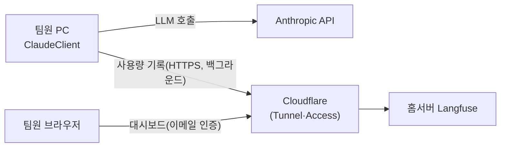

# LLM 사용량 기록 (Langfuse)

Claude API는 토큰만큼 과금되는데 팀원 6명이 각자 호출하고, 키를 우리가 발급하지 않아 콘솔 사용량 화면도 볼 수 없다. 그래서 **모든 LLM 호출을 홈서버의 Langfuse에 기록**해 사람별·기능별·모델별 토큰과 비용을 본다. 이슈 #113, 결정 D-27.

## 구조



- LLM 호출은 지금처럼 각자 PC에서 Anthropic으로 바로 간다. 홈서버는 기록만 받는다.
- **홈서버가 꺼져 있어도 분석·챗봇은 그대로 된다.** 기록만 빠지고, 스크립트가 끝날 때 몇 초 기다린 뒤 경고를 남긴다.
- 서버 운영(구축·키 발급·단가 등록)은 김민우 담당.

## 무엇을 남기나

| 기록 | 언제 | 담는 것 |
|---|---|---|
| trace (`agent`) | 에이전트 실행 1번(`make analyze`, 사건 분석) | 사람(`user_id`), 사건 ID(`session_id`), 태그(진입점·프롬프트 버전), 반복 횟수·도구 호출 수·토큰 합계 |
| generation | LLM 호출 1번. 이름은 아래 "호출 이름" 표 | 모델(대체 모델이 답했으면 실제 모델), 입력·출력·캐시 읽기·캐시 쓰기 토큰, 시간, `stop_reason`, effort, 목적·턴 번호, 오류 |
| tool | 도구 호출 1번 | 도구 이름, 입력 오류면 WARNING |

- **태그(진입점)**: `analyze`, `llm-check`, 기본값 `app`. 새 기능에서 `get_llm_client(entrypoint="chatbot")`처럼 이름을 주면 기능별로 나뉜다.
- **본문은 기본으로 보낸다.** 프롬프트·응답·도구 입력까지 기록한다. 메타데이터만 보내려면 `LANGFUSE_CAPTURE_CONTENT=false`로 끈다.
- API 키, 사번·결재 정보는 어떤 경우에도 보내지 않는다.
- **개인정보 가리기(#212)**: 본문을 보내더라도 이메일·전화번호·주민등록번호 형식은 SDK가 보내기 전에 `[이메일]`·`[전화번호]`·`[주민번호]`로 바꾼다(`agent.tracing.mask_personal`). 설비 ID·오류 코드(`BLDC-001`, `BTT2-P03`)는 그대로 둔다. 사람 이름·사번은 형식만으로 구분할 수 없어 가리지 못하므로, 운영에서 본문 수집이 부담되면 `LANGFUSE_CAPTURE_CONTENT=false`로 끈다.
- **샘플링**: 기록량을 줄이려면 `LANGFUSE_SAMPLE_RATE`(0~1, 예 `0.3`)를 둔다. SDK가 trace 단위로 고르므로 한 질문의 기록은 통째로 남거나 빠진다. 비용 집계(Slack 알림)가 같이 줄어들므로 팀 PC에서는 쓰지 않는다.
- **우리 SDK가 만든 기록만 보낸다**(`should_export_span=is_langfuse_span`). Anthropic SDK도 호출마다 자체 span(`anthropic.messages.create`)을 남기는데, 이것까지 보내면 같은 호출 비용이 두 번 집계된다(#228). 2026-11-05 이전 기록에는 이 중복이 남아 있어, 사용량 알림은 그 이름을 빼고 합산한다.

## 팀원 설정 (한 번만)

진행 상황과 완료 체크는 공지 이슈 #115에서 한다.


1. 최신 `dev`를 받고 `uv sync --locked --no-install-project`
2. 김민우에게 **본인 전용** Langfuse 키(공개 키·비밀 키)를 개별로 받는다
3. `.env`에 넣는다(커밋 금지, 화면 공유·로그에 노출 금지)
   ```bash
   LLM_USER=<본인 GitHub 핸들>
   LANGFUSE_BASE_URL=https://langfuse.<HOME_DOMAIN>
   LANGFUSE_PUBLIC_KEY=pk-lf-...
   LANGFUSE_SECRET_KEY=sk-lf-...
   ```
4. 대시보드: 서버 주소에 접속 → Cloudflare 이메일 코드 인증 → Langfuse 가입(처음 한 번) → 김민우가 프로젝트에 초대
5. 확인: `make analyze`를 한 번 실행하고 1분 안에 Langfuse Traces에 본인 `user_id`로 기록이 보이면 끝

기록이 안 보이면 다음을 차례로 확인한다.
- 터미널에 `Langfuse` 경고가 찍혔는지
- `LANGFUSE_BASE_URL`에 `https://`까지 들어 있는지
- 브라우저로 `<주소>/api/public/health`가 열리는지
- **셸에 `LANGFUSE_*`가 export돼 있지 않은지.** `make`는 `uv run --env-file .env`로 실행하는데, uv는 셸 환경변수를 `.env`보다 우선한다. 다른 도구용으로 셸(`~/.zshrc` 등)에 개인 프로젝트 키를 export해 두면 기록이 그 프로젝트로 가고, 팀 비용 집계·Slack 알림에서 빠진다. 확인: `env | grep -c '^LANGFUSE_'`(0이어야 함). 셸 값을 비우고 `.env`만으로 실행하려면 `env -u LANGFUSE_PUBLIC_KEY -u LANGFUSE_SECRET_KEY -u LANGFUSE_BASE_URL make <명령>`.
- 화면 왼쪽 위 프로젝트가 `weeing-weeing`인지, Environment 필터에 해당 환경(`dev`·`test` 등)이 선택돼 있는지
- (서버 관리자) Langfuse v4는 기록을 ClickHouse `events_core`·`events_full`에 저장한다. 예전 `traces`·`observations` 테이블이 비어 있어도 정상이다. 특정 기록이 어느 프로젝트로 갔는지는 `events_core`에서 `session_id`·`trace_id`로 찾는다.

## 운영 서버(EC2)에서 사람 나누기

EC2 기록도 홈서버 Langfuse로 간다(EC2 전용 프로젝트, 2026-11-05부터. 서버 설정은 [DEPLOY](DEPLOY.md)). EC2는 서버 하나를 팀원 모두가 웹으로 쓴다. `LLM_USER`는 서버에 하나뿐이라, 이 값만 쓰면 모든 호출이 같은 사람으로 남는다.
그래서 **챗봇 질문(`/messages`, `/messages/stream`)은 로그인한 계정의 이름(`name`)을 `user_id`로 쓴다**(`agent.tracing.trace_user`).

- 계정 이름에는 본인 GitHub 핸들을 넣는다. 그러면 직책별 계정(관리자·관제·보전·현장 책임자·점검자) 5개를 써도 PC에서 쓴 기록과 같은 사람으로 묶인다. 실명은 넣지 않는다(Langfuse·Slack에 그대로 보인다)
- 사번은 보내지 않는다
- 로그인과 상관없이 도는 호출(센서가 만든 사건의 자동 분석, 분석 재실행, CLI)은 지금처럼 `LLM_USER`(EC2는 `ec2`)로 남는다. 분석 재실행은 요청한 사람이 아니라 백그라운드 실행기가 부른다

## 비용을 아끼는 약속

- 개발 중에는 `LLM_MODEL=claude-sonnet-5-5` 또는 `claude-haiku-5-5`를 쓰고, Opus(기본값)는 평가·시연 때 쓴다.
- 반복 실행·루프 테스트는 가짜 LLM(테스트)으로 한다. 실제 API는 확인이 필요할 때만 부른다.
- 시연·평가처럼 구분해서 보고 싶으면 `LANGFUSE_TRACING_ENVIRONMENT=demo`처럼 환경 이름을 바꾼다.

## Slack 사용량 알림

홈서버가 Langfuse 기록을 직접 조회해 팀 Slack 채널로 보낸다. 레포 코드나 팀원 설정은 필요 없다.

| 종류 | 언제 | 내용 |
|---|---|---|
| 일일 보고 | 매일 09:00 (KST) | 어제 사람별·모델별 비용, 이번 달 누적과 콘솔 월 한도 대비 %, 크레딧 누적(설정 시) |
| 1인 일일 경고 | 매시 확인 | 한 사람이 하루에 **$0.75**(50%), **$1.50**(100%)에 도달 |
| 팀 월 한도 경고 | 매시 확인 | 이번 달 팀 합계가 Anthropic 콘솔 월 한도 **$30**의 50%·80%·95%에 도달 |
| 조회 실패 | 매시 확인 | 홈서버 Langfuse가 응답하지 않을 때 |

- 같은 경고는 하루에 한 번(월 예산은 한 달에 한 번)만 보낸다.
- 콘솔 월 한도($30)에 닿으면 팀 전체 Claude 호출이 막힌다. 그래서 100%가 아니라 95%에서 알린다. 한도를 올리면 홈서버 `usage-alert/alert.env`의 `MONTHLY_BUDGET_USD`도 같은 값으로 바꾼다.
- 기준(2026-11-03): 받은 크레딧 $150 + $23 = $173. 콘솔 월 한도 $30을 유지하면 11월 남은 기간은 팀 전체가 하루 약 $1이다. 1인 일일 한도 $1.5는 개인 경고이고, 팀 합계는 월 한도 경고로 본다.
- 보내는 것은 GitHub 핸들(`LLM_USER`)·모델 이름·금액뿐이다. 프롬프트·응답은 조회하지 않는다.
- 금액은 아래 단가로 계산한 **추정치**다. 실제 청구서와 다를 수 있다.
- **알림만 하고 호출을 막지는 않는다.** 경고를 받으면 본인이 모델·반복 실행을 줄인다(아래 "비용을 아끼는 약속").

## 단가 등록 키 (서버 관리자용)

비용은 Langfuse에 등록한 모델 단가로 계산한다. 코드가 보내는 토큰 이름이 아래와 같으므로 단가도 같은 이름으로 등록한다.

| usage 키 | 뜻 |
|---|---|
| `input` | 캐시가 아닌 입력 토큰 |
| `output` | 출력 토큰(생각 단계 포함) |
| `cache_read_input_tokens` | 프롬프트 캐시에서 읽은 입력 |
| `cache_creation_input_tokens` | 프롬프트 캐시에 쓴 입력 |

prompt caching(#218): 도구 루프는 도구 정의·SYSTEM과 앞 턴 대화를, 단발 호출(근거 검토·`llm-check`)은 SYSTEM까지를 캐시한다. 캐시는 Anthropic 서버에 5분 보관되며 매 요청이 갱신한다. 챗봇 질문 1건이면 `turn-1`은 `cache_creation_input_tokens`(쓰기, 입력 단가 1.25배), `turn-2`부터는 `cache_read_input_tokens`(읽기, 0.1배)가 보여야 한다. 둘 다 0이면 SYSTEM·도구 정의에 매번 바뀌는 값이 섞였는지 확인한다.

홈서버 Langfuse(4.71.0)의 기본 모델 목록에 아래 세 모델이 위 키 이름 그대로 들어 있어 따로 등록하지 않았다. 2026-10-30에 [공식 가격표](https://platform.claude.com/docs/en/about-claude/pricing)와 대조했다(100만 토큰당 USD).

| 모델 | `input` | `output` | `cache_read_input_tokens` | `cache_creation_input_tokens` (5분) |
|---|---|---|---|---|
| `claude-opus-5-5` | 4 | 20 | 0.20 | 5 |
| `claude-sonnet-5-5` | 2 | 10 | 0.10 | 2.50 |
| `claude-haiku-5-5` (프롬프트 10만 토큰 이하) | 0.10 | 0.50 | 0.01 | 0.125 |

Haiku 5.5는 프롬프트가 10만 토큰을 넘으면 단가가 5배가 된다(Langfuse 기본 정의에 반영됨). 가격이 바뀌면 Langfuse 프로젝트 설정의 Models에서 같은 이름으로 프로젝트 전용 정의를 만들어 덮어쓴다.

## 아직 안 한 것

- **호출을 막는 예산 상한은 없다.** 기록은 사후에 보는 것이다. 1~2주 기록을 보고 필요하면 홈서버에 LLM 게이트웨이(팀원별 가상 키와 예산)를 두는 방법을 따로 정한다.
- API 서버(`make api`)·챗봇은 `get_llm_client`를 쓰면 자동으로 기록된다. 다만 오래 떠 있는 프로세스라 따로 flush하지 않아도 SDK가 주기적으로 보낸다.


## 사건 분석 기록 구조 (#207)

멀티 분석(`ANALYSIS_MODE=multi`) 1건은 trace 하나다. 역할(문서 조사·보고서 조사·통합·검증)은 그 안의 `agent` 기록으로 들어간다. 병렬로 도는 두 조사 단계도 같은 trace에 들어간다. 그래서 대시보드에서 분석 1건당 지연·비용과 결과 상태 비율을 바로 볼 수 있다.

```
incident-analysis (chain)            ← 분석 1건. session=사건 ID, 태그=진입점·multi-analysis-vN
├ incident-documents (agent)         ← 문서 조사(보고서 조사와 병렬)
│ ├ incident-documents.turn-1 (generation)
│ └ search_evidence / get_sensor_window ... (tool)
├ incident-reports (agent)
├ incident-synthesis (agent)         ← 검증이 REVISE면 한 번 더 생긴다
└ incident-verification (agent)
```

| score | 종류 | 언제 |
|---|---|---|
| `analysis.status` | CATEGORICAL | 분석 끝. OK·INSUFFICIENT_EVIDENCE·VERIFICATION_FAILED·FAILED |
| `analysis.failure_code` | CATEGORICAL | FAILED일 때만. 예외 이름 또는 `analysis_timeout` 같은 코드(자유 서술은 남기지 않음) |
| `analysis.llm_calls` | NUMERIC | 이번 실행에서 실제로 보낸 LLM 호출 수(재개 시 재사용한 단계는 빠짐) |

- 실패한 단계부터 다시 돌리는 재개(`resume_analysis`)는 같은 사건 session에 새 trace로 남고 `metadata.resumed=true`다.
- 역할별 진입점 태그(`app:documents` 등)는 이제 바깥 trace에 붙지 않는다. 역할은 안쪽 기록 이름(`incident-<역할>`)으로 구분한다.
- 단일 분석(`ANALYSIS_MODE=single`)은 그대로 에이전트 실행 1번이 trace 하나다.


## 챗봇 기록 구조 (#201)

챗봇 질문 1건은 trace 하나다. 지연 원인을 이름으로 바로 찾을 수 있게 나눠 남긴다.

```
chat (chain)                         ← 질문 1건. session=대화 ID, metadata.run_id=요청 ID
└ chat-assistant (agent)             ← 도구 루프
  ├ chat-assistant.turn-1 (generation)
  ├ search_knowledge (tool)
  │ ├ knowledge.validate_query (span)
  │ ├ knowledge.search (retriever)   ← DB 대상 선정 + RAG 검색 + 서버 출처 확인
  │ └ knowledge.are_searchable (span) ← stage=search_knowledge, 결과 전체를 한 번에 재확인
  ├ chat-assistant.turn-2 (generation)
  └ submit_answer (tool)
    ├ knowledge.are_searchable       ← stage=before_submit
    ├ grounding-review.answer (generation)
    └ knowledge.are_searchable       ← stage=after_review
```

### 호출 이름 (#202)

| 이름 | 뜻 |
|---|---|
| `<에이전트>.turn-<n>` | 도구 루프 n번째 호출(`chat-assistant`, `incident-analyst`). metadata `purpose=tool_loop`, `turn` |
| `grounding-review.answer` / `.clarification` / `.insufficiency` | 챗봇 근거 검토(답변 / 확인 질문 / 근거 부족 설명). metadata `purpose=grounding_review`, `mode` |
| `claude` | 위에 해당하지 않는 단발 호출(`make llm-check` 등) |

코드는 `agent.tracing.generation_label()`로 이름을 정한다. `LlmClient` 메서드 모양은 그대로다.

### 조회 단계 span (#203)

`knowledge.<메서드>` span의 metadata에는 `stage`(어느 도구·단계에서 불렀는지), `kind`·`state`·`source_kind`, `returned`(결과 수)·`sources`·`searchable`(재확인한 출처 수·통과 수)만 남긴다. 출처 재확인은 단계마다 묶어서 한 번 한다(#220). 본문은 남기지 않는다. 임베딩·Qdrant·리랭크 세부 시간은 `knowledge.search` 안에 합쳐져 있다(rag 내부 계측은 #203 후속).

### 세션 (#204)

API(`StoredChatService`)는 `agent.interface.trace_session(대화 ID)` 범위에서 챗봇을 실행한다. 같은 대화의 질문은 Langfuse Sessions에서 한 세션으로 보인다. 요청 ID는 trace metadata `run_id`로 찾는다. CLI(`make chat`)처럼 대화 ID가 없으면 요청 ID가 세션이다. 사건 분석의 세션(사건 ID)은 그대로다.

### 점수 (#205)

| score | 종류 | 언제 |
|---|---|---|
| `chat.status` | CATEGORICAL | 질문 끝. OK·NEEDS_CLARIFICATION·INSUFFICIENT_EVIDENCE·OUT_OF_SCOPE·FAILED |
| `chat.failure_code` | CATEGORICAL | FAILED일 때. TIMEOUT·SEARCH_UNAVAILABLE·RATE_LIMITED 등(응답의 실패 코드와 같은 기준) |
| `chat.llm_calls` | NUMERIC | 질문 끝. 도구 루프 + 근거 검토 호출 수 |
| `chat.grounding_verdict` | CATEGORICAL | 근거 검토마다. SUPPORTED·UNSUPPORTED·CONFLICT. comment에 `<mode> #<몇 번째 검토>` |

Langfuse Traces에서 score로 거르면 "재검토가 일어난 느린 질문", "근거 부족으로 끝난 질문"을 바로 찾을 수 있다. 점수 기록이 실패해도 답변은 그대로 나간다.

### 무과금 기록 확인 (`make langfuse-smoke`, #206)

trace 모양을 바꿨을 때 실제 Claude·Voyage를 부르지 않고 확인한다. LLM 자리는 정해진 응답을 재생하고(`replay-no-cost` 모델, 토큰 0), 기록만 Langfuse로 보낸다.

```bash
make langfuse-smoke                                        # 샘플 매뉴얼 3건, environment=test
make langfuse-smoke ARGS='"모터 과열 점검" --session smoke-1'   # 같은 세션으로 여러 번
make langfuse-smoke ARGS='--real-knowledge'                # 프로젝트 DB·벡터 색인 사용
```

- 기본 environment는 `test`라 dev·demo 기록과 섞이지 않는다(`--environment`로 변경).
- `--real-knowledge`는 비용이 없도록 `EMBEDDING_PROVIDER=hashing`이고 `RERANKER_MODEL`이 비어 있을 때만 실행한다.
- Langfuse 설정이 없으면 기록 없이 결과만 출력한다. 홈서버 대신 `deploy/langfuse`의 로컬 Langfuse에 보내려면 `LANGFUSE_BASE_URL`과 그 서버에서 만든 키를 쓴다.
- 자동 테스트(`tests/scripts/test_langfuse_smoke.py`)는 가짜 Langfuse 클라이언트로 같은 흐름을 검증한다.

## 챗봇 호출 통계 (#89)

대화 도구 루프와 최종 답변 근거 대조는 동일 tracer로 연결된다. 검토용 Claude 호출도
별도 generation이므로 호출 수·토큰에 포함된다. CLI는 last_run의 request_id를 대조하고
호출별 통계를 읽는다. 실제 응답 모델이 있으면 요청 모델 대신 기록한다.
공급자 usage가 없거나 요청이 실패해 사용량을 확인하지 못하면 None이며 합계를 0으로
대신하지 않는다. 재시도 내부의 실제 과금/사용량은 SDK 응답만으로 알 수 없을 수 있다.
Langfuse 자체 오류 및 관측된 예외는 예외 종류만 기록하고 원시 오류 본문은 전송하지 않는다.
