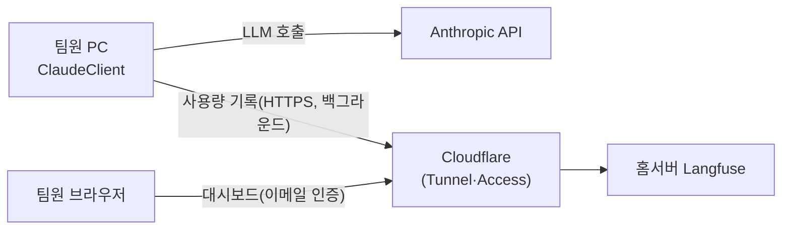

# LLM 사용량 기록 (Langfuse)

Claude API는 토큰만큼 과금되는데 팀원 6명이 각자 호출하고, 키를 우리가 발급하지 않아 콘솔 사용량 화면도 볼 수 없다. 그래서 **모든 LLM 호출을 홈서버의 Langfuse에 기록**해 사람별·기능별·모델별 토큰과 비용을 본다. 이슈 #113, 결정 D-27.

## 구조



- LLM 호출은 지금처럼 각자 PC에서 Anthropic으로 바로 간다. 홈서버는 기록만 받는다.
- **홈서버가 꺼져 있어도 분석·챗봇은 그대로 된다.** 기록만 빠지고, 스크립트가 끝날 때 몇 초 기다린 뒤 경고를 남긴다.
- 서버 운영(구축·키 발급·단가 등록)은 김민우 담당.

## 무엇을 남기나

| 기록 | 언제 | 담는 것 |
|---|---|---|
| trace (`agent`) | 에이전트 실행 1번(`make analyze`, 사건 분석) | 사람(`user_id`), 사건 ID(`session_id`), 태그(진입점·프롬프트 버전), 반복 횟수·도구 호출 수·토큰 합계 |
| generation (`claude`) | LLM 호출 1번 | 모델(대체 모델이 답했으면 실제 모델), 입력·출력·캐시 읽기·캐시 쓰기 토큰, 시간, `stop_reason`, effort, 오류 |
| tool | 도구 호출 1번 | 도구 이름, 입력 오류면 WARNING |

- **태그(진입점)**: `analyze`, `llm-check`, 기본값 `app`. 새 기능에서 `get_llm_client(entrypoint="chatbot")`처럼 이름을 주면 기능별로 나뉜다.
- **본문은 기본으로 보낸다.** 프롬프트·응답·도구 입력까지 기록한다. 메타데이터만 보내려면 `LANGFUSE_CAPTURE_CONTENT=false`로 끈다.
- API 키, 사번·결재 정보는 어떤 경우에도 보내지 않는다.

## 팀원 설정 (한 번만)

진행 상황과 완료 체크는 공지 이슈 #115에서 한다.


1. 최신 `dev`를 받고 `uv sync --locked --no-install-project`
2. 김민우에게 **본인 전용** Langfuse 키(공개 키·비밀 키)를 개별로 받는다
3. `.env`에 넣는다(커밋 금지, 화면 공유·로그에 노출 금지)
   ```bash
   LLM_USER=<본인 GitHub 핸들>
   LANGFUSE_BASE_URL=https://langfuse.<HOME_DOMAIN>
   LANGFUSE_PUBLIC_KEY=pk-lf-...
   LANGFUSE_SECRET_KEY=sk-lf-...
   ```
4. 대시보드: 서버 주소에 접속 → Cloudflare 이메일 코드 인증 → Langfuse 가입(처음 한 번) → 김민우가 프로젝트에 초대
5. 확인: `make analyze`를 한 번 실행하고 1분 안에 Langfuse Traces에 본인 `user_id`로 기록이 보이면 끝

기록이 안 보이면 다음을 차례로 확인한다.
- 터미널에 `Langfuse` 경고가 찍혔는지
- `LANGFUSE_BASE_URL`에 `https://`까지 들어 있는지
- 브라우저로 `<주소>/api/public/health`가 열리는지

## 비용을 아끼는 약속

- 개발 중에는 `LLM_MODEL=claude-sonnet-5-5` 또는 `claude-haiku-5-5`를 쓰고, Opus(기본값)는 평가·시연 때 쓴다.
- 반복 실행·루프 테스트는 가짜 LLM(테스트)으로 한다. 실제 API는 확인이 필요할 때만 부른다.
- 시연·평가처럼 구분해서 보고 싶으면 `LANGFUSE_TRACING_ENVIRONMENT=demo`처럼 환경 이름을 바꾼다.

## Slack 사용량 알림

홈서버가 Langfuse 기록을 직접 조회해 팀 Slack 채널로 보낸다. 레포 코드나 팀원 설정은 필요 없다.

| 종류 | 언제 | 내용 |
|---|---|---|
| 일일 보고 | 매일 09:00 (KST) | 어제 사람별·모델별 비용, 이번 달 누적과 콘솔 월 한도 대비 %, 크레딧 누적(설정 시) |
| 1인 일일 경고 | 매시 확인 | 한 사람이 하루에 **$0.75**(50%), **$1.50**(100%)에 도달 |
| 팀 월 한도 경고 | 매시 확인 | 이번 달 팀 합계가 Anthropic 콘솔 월 한도 **$30**의 50%·80%·95%에 도달 |
| 조회 실패 | 매시 확인 | 홈서버 Langfuse가 응답하지 않을 때 |

- 같은 경고는 하루에 한 번(월 예산은 한 달에 한 번)만 보낸다.
- 콘솔 월 한도($30)에 닿으면 팀 전체 Claude 호출이 막힌다. 그래서 100%가 아니라 95%에서 알린다. 한도를 올리면 홈서버 `usage-alert/alert.env`의 `MONTHLY_BUDGET_USD`도 같은 값으로 바꾼다.
- 기준(2026-11-03): 받은 크레딧 $150 + $23 = $173. 콘솔 월 한도 $30을 유지하면 11월 남은 기간은 팀 전체가 하루 약 $1이다. 1인 일일 한도 $1.5는 개인 경고이고, 팀 합계는 월 한도 경고로 본다.
- 보내는 것은 GitHub 핸들(`LLM_USER`)·모델 이름·금액뿐이다. 프롬프트·응답은 조회하지 않는다.
- 금액은 아래 단가로 계산한 **추정치**다. 실제 청구서와 다를 수 있다.
- **알림만 하고 호출을 막지는 않는다.** 경고를 받으면 본인이 모델·반복 실행을 줄인다(아래 "비용을 아끼는 약속").

## 단가 등록 키 (서버 관리자용)

비용은 Langfuse에 등록한 모델 단가로 계산한다. 코드가 보내는 토큰 이름이 아래와 같으므로 단가도 같은 이름으로 등록한다.

| usage 키 | 뜻 |
|---|---|
| `input` | 캐시가 아닌 입력 토큰 |
| `output` | 출력 토큰(생각 단계 포함) |
| `cache_read_input_tokens` | 프롬프트 캐시에서 읽은 입력 |
| `cache_creation_input_tokens` | 프롬프트 캐시에 쓴 입력 |

홈서버 Langfuse(4.71.0)의 기본 모델 목록에 아래 세 모델이 위 키 이름 그대로 들어 있어 따로 등록하지 않았다. 2026-10-30에 [공식 가격표](https://platform.claude.com/docs/en/about-claude/pricing)와 대조했다(100만 토큰당 USD).

| 모델 | `input` | `output` | `cache_read_input_tokens` | `cache_creation_input_tokens` (5분) |
|---|---|---|---|---|
| `claude-opus-5-5` | 4 | 20 | 0.20 | 5 |
| `claude-sonnet-5-5` | 2 | 10 | 0.10 | 2.50 |
| `claude-haiku-5-5` (프롬프트 10만 토큰 이하) | 0.10 | 0.50 | 0.01 | 0.125 |

Haiku 5.5는 프롬프트가 10만 토큰을 넘으면 단가가 5배가 된다(Langfuse 기본 정의에 반영됨). 가격이 바뀌면 Langfuse 프로젝트 설정의 Models에서 같은 이름으로 프로젝트 전용 정의를 만들어 덮어쓴다.

## 아직 안 한 것

- **호출을 막는 예산 상한은 없다.** 기록은 사후에 보는 것이다. 1~2주 기록을 보고 필요하면 홈서버에 LLM 게이트웨이(팀원별 가상 키와 예산)를 두는 방법을 따로 정한다.
- API 서버(`make api`)·챗봇은 `get_llm_client`를 쓰면 자동으로 기록된다. 다만 오래 떠 있는 프로세스라 따로 flush하지 않아도 SDK가 주기적으로 보낸다.


## 챗봇 호출 통계 (#89)

대화 도구 루프와 최종 답변 근거 대조는 동일 tracer로 연결된다. 검토용 Claude 호출도
별도 generation이므로 호출 수·토큰에 포함된다. CLI는 last_run의 request_id를 대조하고
호출별 통계를 읽는다. 실제 응답 모델이 있으면 요청 모델 대신 기록한다.
공급자 usage가 없거나 요청이 실패해 사용량을 확인하지 못하면 None이며 합계를 0으로
대신하지 않는다. 재시도 내부의 실제 과금/사용량은 SDK 응답만으로 알 수 없을 수 있다.
Langfuse 자체 오류 및 관측된 예외는 예외 종류만 기록하고 원시 오류 본문은 전송하지 않는다.
