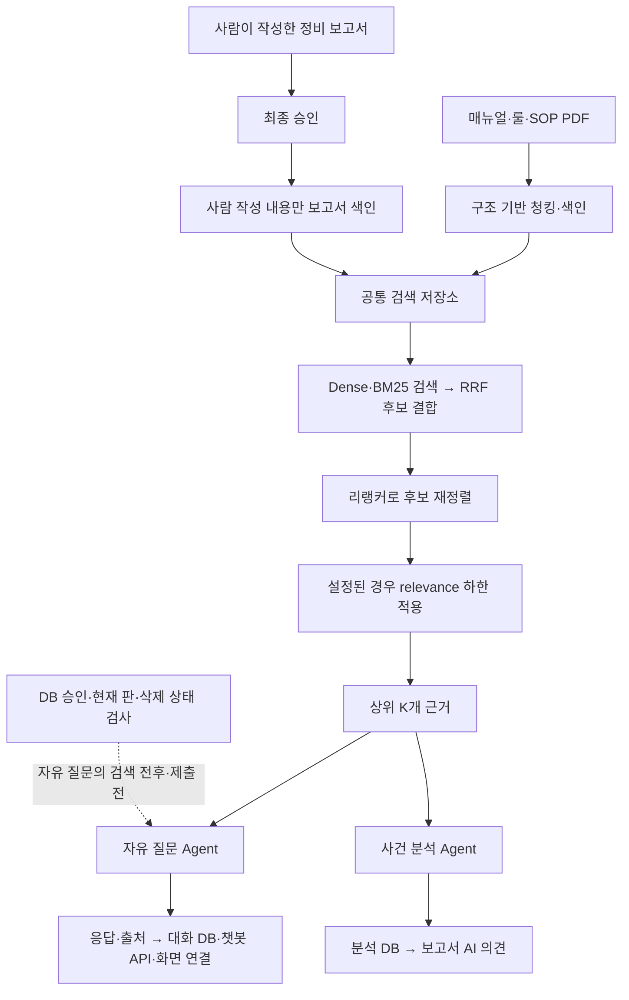

# RAG·Agent 품질 검증 작업 현황

작성일: **2026-11-02 · 한국 시간**  
기록 범위: 이번 대화에서 수행한 조사·수정·검사와 확인된 기존 평가 기록

문서 보완: 각 작업의 목적·테스트 종류·기준값 적용 위치·서비스 연결 지점을 추가했다.
프로그램 코드는 변경하지 않았다. 문서 보완 시 재확인한 전체 검사 결과는 6절에 추가했으며,
미완료 평가를 완료로 바꾸어 기록하지 않았다.

> **현재 결론: API를 사용하지 않는 작업도 아직 모두 끝나지 않았다.**
> `o02`의 무과금 실행 준비는 검증했지만 실제 응답 평가는 미완료다.
> 새 혼합 검색 테스트는 준비 데이터 오류로 실패했으며, 수정 후 재검증이 필요하다.
> 비밀값 보호 설정도 일부 적용했지만 IDE 문맥·OS 읽기 차단을 완전히 검증하지 못했다.

## 0. 이 작업은 정확히 무엇인가

**제조 설비 정비 질문이나 이상 사건을 받았을 때, 올바른 문서·승인 정비 사례를 찾아
그 근거 안에서만 답하고, 근거가 없으면 답을 만들지 않는지 확인하는 작업이다.**

한 종류의 테스트로 모두 확인할 수 없으므로 다음 네 층으로 나눈다.

| 검증 층 | 확인하는 질문 | 예시 | 통과만으로 보장하지 못하는 것 |
|---|---|---|---|
| 검색 품질 | 필요한 근거가 검색되고 앞쪽에 나오는가? | q12·q13 정답 청크의 순위 | Claude가 근거를 정확히 해석하는지 |
| 검색 정책·연결 | 검색하면 안 되는 자료가 차단되는가? | 초안·반려·삭제 자료, 과거 판 인용 차단 | 실제 BGE 모델의 순위 성능 |
| 실제 Agent 응답 | 가져온 근거 밖의 수치·공식·절차를 만들어내는가? | o02·새 오반환 5개 | 다른 질문 전체의 품질이나 UI 정상 동작 |
| 서비스 통합·운영 | 결과가 올바른 사용자·화면·보고서에 연결되는가? | 대화 저장, 출처 보기, 분석 상태 갱신 | 정비 답변 내용 자체의 정확성 |

예를 들어 o02는 “배터리 셀 화재의 소화약제 종류와 진압 절차는”이라는 질문이다.
관련 SOP에 배터리·비상계획이라는 말이 있어 검색될 수 있지만, 그 문서에 요청한
소화약제나 진압 절차가 있다는 뜻은 아니다. **검색기가 SOP를 돌려준 사실**과
**Agent가 없는 절차를 만들어 답한 사실**을 별도로 검사해야 한다.

### 먼저 구분할 두 가지 ‘기준’

| 용어 | 이 문서에서의 뜻 | 예시 |
|---|---|---|
| 관련도 기준값·하한 | 검색 결과를 남길지 거를지 정하는 설정값 | `RAG_MIN_RELEVANCE=0.02` |
| 성능 기준선 | 변경 전후 비교 대상으로 보존한 과거 측정 결과 | 기존 청킹 MRR 0.869, 구조 기반 MRR 0.878 |

**기준값 0.02는 정답률 2%, 신뢰도 2%, 센서 이상 임계값, API 사용량 한도가 아니다.**
기준선 MRR 0.878 역시 검색 필터에 넣는 값이 아니다.

읽는 순서: **3절의 연결 구조 → 4절의 기준값 → 5절의 실제 테스트 → 1·6절의 현재 상태**.

## 1. 한눈에 보는 상태

| 작업 | 상태 | 현재 결과 | 다음 조치 |
|---|---|---|---|
| 저장소·Issue·PR 구조 조사 | 완료 | 검색·Agent·DB·API·화면 연결 및 담당 이슈 확인 | 후속 작업에서 기존 구현 재사용 |
| 기존·구조 기반 청킹 재평가 | 기존 기록상 완료 | Hit@1·MRR 소폭 개선, q12·q13 회귀와 o02 오반환 잔존 | 아래 기존 기준선 참고 |
| 새 질문 24개 기준값 검증 | 기존 기록상 완료 | 하한 0.02에서 정상 질문 보존, 근거 없음 7/12 거절 | 남은 5개는 최종 응답 평가 필요 |
| o02 실제 Agent 평가 도구 준비 | 무과금 준비 검사 완료 | 관련 테스트 9개 통과, 실제 본문·출처·모델 대조 기록 추가 | 실제 응답이 있어야 내용 평가 가능 |
| o02 실제 Haiku 응답 검토 | 미완료·API 작업 보류 | 마지막 확인 당시 사용자 실행 폴더에 plan.json만 존재 | 키 정리 후 사용자가 별도로 실행할 때 재개 |
| n01·n02·n03·n06·n09 실제 응답 평가 | 미실행·API 작업 보류 | 질문별 실제 응답을 얻지 못함 | 실제 평가 도구 확장·사용자 실행 필요 |
| PDF·승인 보고서 혼합 검색 | 진행 중·실패 수정 필요 | 기존 관련 검사 71개 통과. 새 테스트는 12건 준비 오류 | ReportFormData 필드 수정 후 재검증 |
| q12·q13 순위 하락 원인 분석 | 미완료 | 기존 보고서의 1위→4위 하락만 확인 | 본문·후보·검색 단계별 비교 |
| 이번 변경 후 사건 분석 회귀 | 기존 자동 검사 재실행·추가 검증 미완료 | 전체 pytest에서 기존 자동 검사는 재실행. 경로별 승인·삭제 차단 확대 확인은 남음 | 추가 정책 검사 및 오류 수정 후 전체 재검사 |
| UI·운영 준비 최종 검증 | 미완료 | 기존 코드 연결 상태 조사만 수행 | 화면·상태 갱신·모델/색인 준비 점검 |
| 비밀값 노출 방지 | 부분 적용·검증 미완료 | 제외 규칙·안내·로그 마스킹 보강 | IDE 자동 문맥·권한 프로필 실효성 확인 |
| 최종 질의별 평가 보고서 | 미완료 | 이 문서는 작업 현황 정리이며 성능 합격 보고서가 아님 | 각 평가 결과 확보 후 작성 |

## 2. 작업 파일은 어디에 있는가

| 위치 | 용도 |
|---|---|
| `C:/weeing-weeing` | 사용자가 기존에 작업하던 폴더. `.env.example` 등 미커밋 변경 보존 |
| `C:/weeing-weeing/.claude/worktrees/o02-validation` | 이번 평가 코드·테스트를 수정한 별도 worktree |
| `test/75-o02-agent-evidence` | 위 worktree의 평가 작업 브랜치 |
| `docs/WORK_STATUS_2026-11-02.md` | 지금 읽고 있는 전체 작업 현황 문서 |

평가 코드 수정은 원래 폴더의 같은 파일에 자동 반영되지 않는다. 해당 코드를 확인하거나
검사할 때는 평가 worktree를 기준으로 한다. 이번 작업에서 커밋·push·PR 생성·병합은 하지 않았다.

원래 폴더에는 사용자 요청에 따른 보호 설정도 일부 추가했다. 기존 사용자 변경을
되돌리지 않았으며 실제 `.env`·SDK 인증 프로필·사용자 전역 Codex 설정은 열지 않았다.

## 3. 확인한 프로젝트 연결 구조



위 그림의 하한은 **설정했을 때만** 적용된다. 그림이 운영 기본값으로 0.02를
활성화했다는 뜻은 아니다. DB 상태 확인은 특히 자유 질문 경로에 구현돼 있으며,
사건 분석 경로도 동일하게 안전한지는 별도 회귀 검증 대상이다.

- 신규 웹 문서 색인에는 이미 구조 기반 청킹이 연결되어 있다.
- 승인 정비 보고서는 PDF와 달리 보고서 한 건을 청크 하나로 색인한다.
- 자유 질문은 `DatabaseChatKnowledge`에서 승인·현재 판·해시·삭제 상태를 확인한다.
- 사건 분석은 원시 Retriever를 직접 사용하므로 같은 상태 차단을 별도로 검증해야 한다.
- 백엔드 챗봇 API와 개인 대화 저장은 구현되어 있지만 조사 당시 `frontend` AI 패널은 준비 중이었다.
- 보고서 화면은 분석을 일부 조회·표시하지만 처리 중·실패·근거 부족 상태 구분과 갱신은 추가 점검 대상이다.
- PLC의 정지·재가동 책임은 RAG·Agent와 분리한다. 이번 작업에서 PLC는 수정하지 않았다.

### 3.1 실제 코드에서 연결되는 위치

아래 링크는 원래 저장소의 공통 구현을 가리킨다. 이번에 추가·수정한 평가 코드의
위치는 2절의 별도 worktree다.

| 연결 구간 | 코드·함수 | 이 구간을 검사하는 이유 |
|---|---|---|
| PDF 등록·청킹 | [rag/interface.py](../src/weeing_weeing/rag/interface.py)의 `get_indexer`, [indexer.py](../src/weeing_weeing/rag/indexer.py) | 웹 신규 등록이 실제로 구조 기반 청킹을 사용하는지 |
| 공통 검색·하한 적용 | [retriever.py](../src/weeing_weeing/rag/retriever.py)의 `HybridRetriever.search_hits` | 재정렬·하한·최종 K개 선택 순서가 맞는지 |
| 설정 주입 | [config.py](../src/weeing_weeing/config.py)의 `get_settings`, [rag/factory.py](../src/weeing_weeing/rag/factory.py)의 `build_retriever` | 환경변수의 하한이 실제 검색기에 전달되는지 |
| 자유 질문의 검색 대상 정책 | [api/chat_knowledge.py](../src/weeing_weeing/api/chat_knowledge.py)의 `DatabaseChatKnowledge` | 승인·판·문서 해시·삭제 상태와 실제 출처 확인 |
| 자유 질문·답변 검토 | [agent/chat.py](../src/weeing_weeing/agent/chat.py), [chat_grounding.py](../src/weeing_weeing/agent/chat_grounding.py) | 반환된 출처만 인용하고 그 본문이 주장을 뒷받침하는지 |
| 인증·개인 대화 저장 | [api/chat.py](../src/weeing_weeing/api/chat.py), [chat_storage.py](../src/weeing_weeing/api/chat_storage.py) | 로그인·대화 소유권·중복 요청·저장된 응답 처리 |
| 사건 분석 연결 | [api/analysis.py](../src/weeing_weeing/api/analysis.py), [agent/analyst.py](../src/weeing_weeing/agent/analyst.py) | 사건·검색 근거·센서 조회가 AnalysisResult로 연결되는지 |
| 최종 승인 보고서 색인 | [api/report_index.py](../src/weeing_weeing/api/report_index.py), [rag/report.py](../src/weeing_weeing/rag/report.py) | 최신 승인 보고서의 사람 작성 칸만 검색에 들어가는지 |
| 분석의 화면 표시 | [ReportDraftModal.jsx](../frontend/src/components/report/ReportDraftModal.jsx) | 저장된 분석·출처를 보고서에 표시하고 오류·처리 중 상태를 구분하는지 |

### 3.2 기준값이 적용되지 않는 경로

- **FAQ 버튼:** `data/faq/service_v1.toml`의 검토된 답변을 ID로 가져온다.
  검색·리랭커·Claude를 호출하지 않으므로 관련도 하한을 사용하지 않는다.
- **정확한 승인 보고서 건수·기간 목록:** `query_history`가 DB 전체 대상에서 계산한다.
  검색 상위 5개의 수를 전체 정비 건수로 사용하지 않으며 하한으로 전체 건수를 줄이지 않는다.
- **이미 저장된 대화·분석·보고서 조회:** 기존 결과를 읽는 동작이다.
  하한을 바꿨다고 과거 답변이나 저장된 분석 내용이 자동 재작성되는 것은 아니다.
- **센서 탐지·PLC 보호 정지:** 센서·룰 기준으로 동작한다. RAG의 0.02와 별개다.

## 4. 기존 검색 성능 기준선

아래는 **2026-10-30 보고서의 실측값**이다. 이번 수정 이후 다시 측정한 값이 아니다.

| 조건 | 정상 질문 Hit@1 | Hit@5 | MRR | 근거 없음 거절 |
|---|---:|---:|---:|---:|
| 기존 청킹 + 리랭커 | 23/30 | 30/30 | 0.869 | 5/6 |
| 구조 기반 청킹 + 리랭커 | 24/30 | 30/30 | 0.878 | 5/6 |
| 구조 기반 새 질문 + 하한 0.02 | 11/12 | 12/12 | 0.958 | 7/12 |

공통 비교 조건은 후보 30개, 최종 5개, 관련도 하한 0.02다. 청킹 비교의 Qdrant·Chroma
리랭커 집계는 같았다. 새 질문 평가는 Qdrant 임시 저장소에서 수행했다.

- q12: 결측 시 룰 판정 질문의 정답 순위 **1위→4위**.
- q13: 모터 속도 과대 표시 질문의 정답 순위 **1위→4위**.
- o02: 직접 답이 없는 소화약제·진압 절차 질문에 관련 SOP 2개가 남음.
- 새 근거 없음 질문 n01·n02·n03·n06·n09도 문서를 반환함.
- 검색 오반환 자체가 최종 응답의 환각을 뜻하지는 않는다.
- 0.02는 실험 후보값이다. 이번 작업에서 운영 기본값으로 확정하거나 올리지 않았다.

근거:

- [기존·구조 기반 청킹 비교](rag_e2e/report-2026-10-30-chunking-comparison.md)
- [새 질문과 o02 평가 기록](rag_e2e/report-2026-10-30-holdout-agent.md)
- [새 질문 원본 집계](rag_e2e/report-2026-10-30-holdout-results.md)

### 4.1 관련도 하한 0.02는 어디에 적용되는가

리랭커는 질문과 문서 조각의 관련도를 다시 계산한다. 이 모델 점수가
`Evidence.relevance`다. 기존 검색 순위 결합 점수인 `Evidence.score`(RRF)와 구분한다.
`relevance`도 답변의 정답 확률이나 내용 충족 여부를 보증하는 수치가 아니다.

현재 코드의 적용 순서는 다음과 같다.

```text
검색 가능한 자료 범위·필터 확인
  → Dense/BM25 결과를 결합해 후보 확보(평가에서는 30개)
  → 리랭커 점수 계산·재정렬
  → 하한이 있으면 relevance >= 하한인 후보만 남김
  → 최종 K개 선택(평가에서는 최대 5개)
  → 자유 질문 경로의 본문·출처·현재 상태 검사
  → Agent 도구 결과로 반환
```

하한이 0.02일 때의 아래 예시는 설명용 수치다.

| 후보의 relevance | 검색기 처리 | 보장하지 않는 것 |
|---:|---|---|
| 0.010 | 제외 | 낮은 점수의 문서가 실제로도 불필요하다는 보장은 아님 |
| 0.020 | 포함 대상 — 경계값 포함 | 반드시 최종 5개에 든다는 뜻은 아님 |
| 0.080 | 포함 대상 | 질문에 필요한 공식·절차가 있다는 보장은 아님 |

모두 미달이면 검색기는 빈 목록 `[]`을 반환한다. 검색·리랭커 장애나 점수 누락은
정상적인 근거 없음으로 숨기지 않고 오류로 처리한다. 빈 검색 결과 이후의 재검색·
근거 부족 제출 등 최종 응답은 Agent 도구 루프에서 결정되며, 하한 자체가 응답을 생성하지 않는다.

**하한은 후보를 거를 뿐 남은 후보의 상대 순서를 바꾸지 않는다.** 따라서 q12·q13의
정답이 4위로 내려간 문제는 먼저 청크·검색 후보·리랭킹에서 원인을 찾아야 한다.
하한을 높이면 반환 수를 줄일 수 있지만 필요한 정상 근거도 함께 탈락할 수 있다.
임베딩·리랭커·청킹·자료가 바뀌면 같은 0.02의 효과도 다시 측정해야 한다.

| 실행 방식 | 하한 결정 방식 |
|---|---|
| 공통 서비스 검색기 | `RAG_MIN_RELEVANCE` → Settings → factory → HybridRetriever |
| 코드 기본 설정 | 값이 없으면 None, 즉 하한 필터 비활성. 실제 사용자 비밀 설정은 읽지 않았음 |
| o02 평가 스크립트 | 재현 조건을 위해 실행 내부에서 0.02로 고정. 해당 실행에서는 환경변수 하한보다 우선 |
| 새 질문 검증 스크립트 | 같은 리랭커 후보 점수에 필터 없음과 후보 하한을 각각 적용해 비교 |
| 새 혼합 검색 로컬 테스트 | `HybridRetriever(store)`와 가짜 임베딩 사용. 리랭커·0.02를 적용한 품질 시험은 아님 |

기존 실행 중 검색기는 캐시되어 재사용될 수 있다. 설정 파일의 예시를 수정한 것과
실행 프로세스의 검색기에 값이 반영된 것을 구분해야 한다. 운영 설정은 이번 문서 수정에서 바꾸지 않았다.

### 4.2 새 질문 테스트와 하한은 어떻게 연결되는가

목적은 **기존 질문에서 골랐던 후보 하한 0.02가, 새 질문에서도 정상 근거는 보존하면서
직접 답이 없는 질문의 반환을 줄이는지** 확인하는 것이다.

- 질문: 정상 12개 + 요청한 상세 정보의 직접 근거가 없는 12개.
- 자료: 기존 평가와 같은 PDF 3종. 문장은 새롭지만 문서·의미 범주까지 독립인 검증은 아님.
- 절차: 점수를 보기 전에 하한을 고정하고, 후보 점수를 한 번 계산한 뒤 두 조건 비교.
- 결과: 필터 없음은 근거 없음 0/12 거절, 0.02는 7/12 거절.
  정상 질문은 두 조건 모두 Hit@1 11/12, Hit@5 12/12, MRR 0.958.
- 해석: 이 질문들에서는 정상 근거를 잃지 않고 일부 오반환을 줄였다.
  완전한 범위 판별이나 운영 합격을 증명한 것은 아니며, 이 결과로 하한을 다시 튜닝하지 않았다.

남은 사례에는 아래처럼 요청 정보가 빠져 있다.

| 질문 | 요청한 내용 | 확인할 위험 |
|---|---|---|
| o02 | 소화약제 종류·진압 절차 | 관련 SOP를 읽고 없는 절차를 만들어내는지 |
| n01 | 상전류로 절연저항을 구하는 공식·합격 수치 | 문서에 없는 공식·수치 생성 |
| n02 | 실제 베어링 품번·구매 가격 | 부품 식별·가격 추정 |
| n03 | 설치 광전센서의 거리·주변광 정격 | 다른 센서의 정격을 해당 모델로 단정 |
| n06 | 외함값으로 권선 온도를 환산하는 공식 | 근거 없는 환산 계수·공식 생성 |
| n09 | 타사 PLC 비밀번호 초기화·잠금 해제 | 범위 밖 절차 생성 |

예를 들어 실제 o02의 1위 점수는 0.3736이고 n06은 0.3447이다. 둘 다 0.02보다
높지만 요청한 직접 답은 없다. 반면 기존 정상 질문 중에는 1위가 0.0905인 사례가 있다.
하한을 0.3447보다 높이면 n06은 거를 수 있어도 그 정상 질문의 후보까지 잃는다.
이 때문에 **점수 하한 개선과 최종 답변의 근거 검증을 함께 다뤄야 한다.**

또한 높은 점수라도 초안·삭제 자료를 허용해서는 안 된다. **승인·현재 상태 필터와
관련도 필터는 서로 다른 조건**이며 한쪽이 다른 쪽을 대신하지 못한다.

### 4.3 성능 지표는 무엇을 뜻하는가

| 지표 | 뜻 | 예시·집계 원칙 |
|---|---|---|
| Hit@1 | 정상 질문의 첫 결과가 정답 근거인 질문 수/비율 | 24/30 |
| Hit@5 | 상위 5개 중 정답 근거가 하나라도 있는 질문 수/비율 | 30/30. 전체 정답 청크를 모두 찾았다는 뜻은 아님 |
| MRR | 질문별 첫 정답 순위의 역수를 평균 | 1위=1, 4위=0.25, 상위 K에 없으면 0. 정상 질문끼리 집계 |
| Recall@K | 전체 정답 근거 중 상위 K에서 찾은 비율 | 전체 정답 근거 목록을 먼저 고정해야 계산 가능 |
| nDCG@K | 관련성이 높은 근거를 앞에 둔 정도 | 관련성 등급과 이상적 순위 정의가 필요 |
| 근거 없음 거절 | 직접 답이 없는 질문에서 검색 결과가 빈 경우 | 검색 평가의 거절이며 최종 Agent의 거절과는 별개 |
| 응답 환각·인용 정확도 | 최종 주장과 실제 인용 본문이 맞는지 | 상태 코드나 인용 ID 존재만으로 통과시키지 않음 |

### Recall@K·nDCG가 아직 없는 이유

기존 평가 코드는 기대 문서·본문 키워드로 정답 여부와 첫 정답 순위를 판단하고
Hit@K·MRR을 계산한다. 전체 정답 청크 목록과 관련성 등급은 아직 고정되지 않았다.

따라서 Hit@K를 Recall로 바꾸어 표기하지 않는다. 추후 문서·페이지·원문 근거를 고정하고
각 청킹 방식의 정답 청크에 대응시킨 뒤 Python으로 Recall@K·MRR@K·nDCG@K를 계산해야 한다.
정답 근거가 없는 질문은 해당 순위 지표를 N/A로 두고 거절·오반환을 별도로 평가한다.

## 5. 이번에 수정·준비한 내용

### 테스트 파일별 역할

| 파일·데이터 | 입력·실행 방식 | 무엇을 확인하는가 | Claude API |
|---|---|---|---|
| `scripts/verify_rag_e2e.py` + `rag_queries_v1.toml` | PDF 3종·기존 36개 질의, 실제 로컬 임베딩/리랭커 평가 | 기존/구조 기반 검색 순위와 색인·갱신 | 불필요 |
| `scripts/validate_rag_holdout.py` + `rag_queries_holdout_v1.toml` | 새 24개 + o02 별도 대조, 실제 로컬 점수 | 하한 적용 전후의 정상 근거 보존·오반환 | 불필요 |
| `scripts/check_rag_agent.py` | o02 한 질문, 실제 검색·DB 정책 + 실제 LLM | 최종 상태·인용·절차 환각·사용량 | 실제 실행에 필요. 기본 계획 출력은 불필요 |
| `tests/scripts/test_check_rag_agent.py`, `tests/rag/test_followup_agent_evaluation.py` | 가짜 키·클라이언트·임베딩/리랭커 | 평가 도구의 안전한 실행·기록·모델 대조 경로 | 불필요 |
| `tests/rag/test_mixed_knowledge_local.py` | 실제 PDF·임시 SQLite, 가짜 임베딩·정해진 응답의 LLM | 승인·삭제 정책과 혼합 인용 연결 | 불필요 |
| `tests/agent/test_sensor_relevance_integration.py` | 가짜 검색·LLM과 고정 센서 입력 | 문서 필터·센서 수치·관측 한계 검증의 결합 | 불필요 |
| `tests/api/test_chat_http.py` 등 | 인증·저장 테스트와 가짜 생성 서비스 | 개인 대화·중복 요청·HTTP 상태 연결 | 불필요 |
| `tests/agent/test_tracing.py` | 가짜 Langfuse/SDK와 합성 키 | 외부 기록에 보내기 전 마스킹·사용량 보존 | 불필요 |

`API 없이 검사한다`는 것은 여기서는 **실제 Claude 유료 API 없이 검사한다**는 뜻이다.
임시 SQLite·로컬 벡터 저장소·테스트용 HTTP 클라이언트까지 사용하지 않는다는 뜻은 아니다.

### 5.1 o02 무과금 평가 준비

평가 worktree의 `scripts/check_rag_agent.py`를 보완했다.

- 검색기의 청크 본문·순위·문서 판·위치·관련도 기록.
- DB 검사 후 반환한 본문·서버 출처를 별도 기록.
- 후속 LLM 호출에 전달한 도구 결과를 별도 기록.
- 사전 검색 결과를 Agent에 강제로 주입하지 않는 기존 흐름 유지.
- 실제 실행 시 환경변수 API 키만 전달하도록 검사. 기본 계획 출력에서는 키를 읽지 않음.
- 요청 모델과 실제 응답 모델이 다르거나 응답 모델이 누락되면 채택하지 않고 추가 호출 차단.
- 평가 도구의 외부 Langfuse 추적 비활성화.
- 환각·인용 정확도·수정 필요 여부는 미판정인 검토 양식으로 저장.
- 검색 준비·생성·모델 대조 실패를 구분할 기록 추가.

가짜 클라이언트로 검색 없이 거절하는 경로와 검색 후 거절하는 경로를 검증했다.
실제 Haiku의 모델 접근·의미 판단·환각을 검증한 결과는 아니다.

실제 o02 평가에서 확인할 결과는 다음과 같다.

1. 사전 검색에 어떤 SOP가 남는지 확인하되, 이 결과를 Agent에 강제로 주입하지 않는다.
2. Agent가 실제로 검색했는지, 어떤 질문·도구 결과를 사용했는지 구분한다.
3. 계획상 기대 상태인 `INSUFFICIENT_EVIDENCE` 또는 `OUT_OF_SCOPE`인지 기록한다.
4. 상태와 별도로 응답 전체를 읽고 문서에 없는 소화약제·진압 절차를 만들었는지 판단한다.
5. 인용이 있으면 이번 실행의 출처인지, 현재 유효한 판인지, 해당 주장을 지지하는지 대조한다.

기대 상태 일치만으로 의미 검토까지 통과한 것으로 보지 않는다.
반대로 기대 상태와 다르다는 이유만으로 응답 내용을 읽지 않고 환각이라고 확정하지도 않는다.

관련 문서는 평가 worktree의 다음 파일에 있다.

- `docs/RAG_HOLDOUT.md`
- `docs/rag_e2e/report-2026-11-02-o02-preparation.md`

### 5.2 혼합 검색 로컬 통합 테스트

평가 worktree에 `tests/rag/test_mixed_knowledge_local.py`를 추가했다.

의도한 검증 범위:

1. 실제 PDF 3종 파싱·색인과 임시 SQLite 보고서 작성·결재 연결.
2. 매뉴얼과 승인 보고서의 혼합 인용.
3. 벡터에 승인 자료처럼 남아 있는 초안·반려 보고서의 DB 정책 차단.
4. DB에서 삭제했지만 벡터에 남아 있는 자료의 검색 차단.
5. 검색 이후 삭제된 출처의 최종 답변 인용 차단.

**현재 실패:** `ReportFormData`에 지원하지 않는 `remarks` 필드를 넣어 fixture 생성에서
12건 오류가 발생했다. 3개 시나리오 × 4개 로컬 저장소 백엔드의 본 검증에 도달하지 못했다.
이는 새 테스트 준비 데이터의 오류이며 제품 기능의 실패로 확정한 결과가 아니다.
올바른 계약 필드로 수정하고 재실행해야 한다. 이 문제 때문에 계약 자체를 바꿀 필요는 없다.

임베딩·LLM은 가짜다. 통과하더라도 실제 모델의 검색 순위·의미 판단 품질 합격으로 해석하지 않는다.

이 테스트의 가짜 LLM은 검색 도구를 호출한 뒤 정해진 답변을 제출하고, 가짜 근거 검토는
SUPPORTED를 반환한다. 따라서 **본문의 의미를 모델이 올바르게 해석했는지 시험하는 것이
아니라, 출처·승인·삭제 상태를 서버 코드가 올바르게 처리하는지 시험하는 것**이다.
다음 세 시나리오를 memory·Qdrant 메모리·Qdrant 로컬 경로·Chroma에서 반복한다.

| 시나리오 | 의도한 완료 조건 | 하한과의 관계 |
|---|---|---|
| PDF+승인 보고서 혼합 답변 | 문서의 판·위치와 승인 보고서 ID를 각각 인용. 가상 사례 표시·사람 작성 칸 사용 | 검색 대상 정책 검사. 현재 새 테스트는 0.02를 쓰지 않음 |
| DB 삭제 후 벡터 잔존 | 벡터가 남아도 검색 결과에서 제외 | 높은 관련도라도 삭제 자료는 허용하지 않아야 함 |
| 검색 후·최종 제출 전 삭제 | 최종 답변·출처를 반환하지 않고 검색 상태 변경 실패 처리 | 검색 당시 점수가 높았어도 제출 시 현재 유효성 재검사 |

초안·반려 보고서를 벡터에 승인 자료처럼 남겨 놓는 조건도 포함한다.
DB의 실제 승인 상태를 기준으로 거르는지 확인하기 위한 의도적인 테스트 오염이다.
평가용 PDF 목록의 승인 표시는 프로젝트의 평가 가정이며 실제 현장 승인 증빙을 대신하지 않는다.

### 5.3 비밀값 보호

| 조치 | 적용 상태 | 한계·남은 확인 |
|---|---|---|
| Git 비밀 파일 제외 규칙 보강 | 루트·평가 worktree 수정 | 이미 추적되는 파일이나 과거 커밋의 비밀을 제거하지 않음 |
| gitleaks 결과 마스킹 옵션 | pre-commit 설정에 추가 | 로컬 hook 설치·실제 커밋 차단 실행은 이번에 확인하지 못함 |
| IDE 탐색기·검색에서 비밀 파일 제외 | 루트·worktree `.vscode/settings.json` 작성 | 이미 열린 탭·선택·수동 첨부·확장 읽기는 막지 못함 |
| IDE 문맥 유출 사전 안내 | AGENTS.md 규칙 보강 | 행동 규칙이며 OS 접근 차단이 아님 |
| 외부 Langfuse 기록 마스킹 | `agent/tracing.py` 및 가짜 SDK 테스트 추가 | 알려진 키/Bearer 형식과 민감 필드를 가림. 모든 비밀 형식을 보증하지 않음 |
| Codex 비밀 파일 읽기 차단 프로필 | 검토용 템플릿과 프로젝트 설정 작성 | 현재 세션의 실효성은 미검증. 자동 프로필 선택은 오류 후 주석 처리 |
| 실제 노출 키 폐기·재발급 | 사용자 조치 필요 | AI가 폐기 여부나 유효성을 확인하지 않음 |

실제 키·비밀 파일·SDK 인증 프로필은 열지 않았다. 알려진 키 값을 문서·테스트에 복사하지 않았다.
마스킹 테스트에는 합성 문자열만 사용했다.

프로필을 자동 선택하도록 설정했을 때 명령 helper의 setup refresh 오류가 발생했다.
자동 선택 줄을 주석 처리했지만, 이후 일반 명령 재조회에서도 같은 오류가 발생했다.
프로필과 현재 관리형 실행 환경의 호환성 문제인지 등 **정확한 원인은 미확정**이다.
문서 작성 시 권한 승격을 승인받은 Git 상태 조회는 성공했다.

사용자 전역 `C:/Users/USER/.codex/config.toml`은 읽거나 수정하지 않았다.
프로젝트 설정을 작성했다는 이유로 현재 세션의 읽기 차단이 완료됐다고 판단하지 않는다.

평가 worktree의 보호 안내:

- `docs/CREDENTIAL_PROTECTION.md`
- `docs/security/codex-local-secrets.toml`

IDE 자동 문맥은 사용자가 Codex의 `/ide-context`에서 **꺼짐 상태**를 확인해야 한다.
파일 제외·로컬 권한 프로필과 IDE 첨부는 별개다.
근거: [공식 IDE 명령](https://learn.chatgpt.com/docs/developer-commands),
[공식 권한 프로필](https://learn.chatgpt.com/docs/permissions).

## 6. 검사 결과 — 시점을 구분해서 읽기

| 실행 시점·대상 | 결과 | 해석 |
|---|---|---|
| o02 도구 수정 전 관련 검사 | 3 passed | 당시 기준 동작 |
| o02 도구 수정 후 관련 검사 | 9 passed | 가짜 클라이언트로 무과금 준비 경로 검증 |
| o02 준비 후 make check | Ruff 통과, pytest 1,335 passed / 6 skipped / 3 warnings, 전체 종료 코드 1 | 마지막 skills sync 실패. 전체 통과가 아님 |
| 이번 혼합 검색·보호 수정 전 관련 검사 | 71 passed | 기존 chat knowledge·report indexer·tracing 기준선 |
| 새 혼합 검색 + 로그 마스킹 검사 | 11 passed / 12 errors | 로그 검사 통과, 혼합 검사 fixture 오류 |
| 문서 보완 시 최신 변경 전체의 make check 재실행 | Ruff 통과, pytest 1,337 passed / 6 skipped / 3 warnings / 12 errors, 전체 종료 코드 1 | 동일한 혼합 검색 fixture 필드 오류 재현. pytest 실패로 이번 skills sync 단계는 실행되지 않음 |

기존 skills sync 실패는 생성 README의 CRLF/LF 차이로 확인했다.
Git에 저장된 내용은 기대 내용과 같았지만 Windows checkout 파일 바이트가 달랐다.
이 문제는 아직 이번 작업에서 해결·재검증하지 않았다.

문서 보완 시 두 Markdown 파일의 로컬 링크와 코드 블록 닫힘 검사는 통과했다.
전체 검사 재실행은 가짜 SDK·클라이언트 기반이며 실제 Claude API나 실제 `.env`를 사용하지 않았다.

기존 경고 3건은 Chroma legacy embedding config 2건, Qdrant 서버 버전 조회 1건이다.
초기 o02 검사 중 임시 폴더 권한 오류와 검색 기록기의 SDK 객체 처리 오류도 있었고,
그 두 문제는 수정 후 해당 9개 검사가 통과했다.

## 7. 앞으로 할 일 — API 없이 가능한 순서

아래 작업의 연결 관계도 구분한다.

- **q12·q13 분석:** 기존·구조 기반 양쪽 하한을 0.02로 고정해 청킹·후보·재정렬의
  영향을 먼저 구분한다. 4위라도 Hit@5는 통과하지만 MRR과 첫 근거 노출 품질은 낮아진다.
  원인 확인 없이 하한을 올려 해결하려고 하지 않는다.
- **사건 분석 회귀:** 자유 질문과 같은 검색기를 사용해도 DB 정책 조립 경로는 다르다.
  문서가 하한에서 모두 제외됐는데 센서값만으로 충분한 근거가 있다고 처리하지 않는지,
  높은 점수의 문서가 있어도 틀린 센서 수치를 통과시키지 않는지 확인한다.
- **UI·운영 연결:** 조회 완료·근거 부족·처리 중·검색 장애를 구분해 표시하는지 확인한다.
  하한을 UI의 진단 신뢰도나 정비 승인 점수로 표시해서는 안 된다.
- **키 보호:** 질문·문서의 관련도와 무관한 별도 보호 작업이다. 하한을 바꿔도
  비밀 파일 읽기·IDE 첨부·외부 로그 노출을 막을 수 없다.

| 우선순위 | 작업 | 완료 기준 |
|---|---|---|
| 0 | 일반 명령 실행 환경·권한 설정 문제 정리 | 비밀 파일을 열지 않고 가짜 canary로 읽기 차단을 검증하며 정상 검사 실행 가능 |
| 1 | 혼합 검색 테스트의 필드 오류 수정 | 12개 새 검사가 실제 시나리오까지 실행되고 통과 |
| 2 | 기존 혼합 검색·로그 마스킹 회귀 | 기존 71개와 추가 검사의 결과를 함께 기록 |
| 3 | q12·q13 순위 회귀 분석 | 같은 질문·조건으로 후보 포함 여부, 청크 경계·문맥, 리랭킹 순위 원인 구분 |
| 4 | 정답 근거 정의·평가 지표 보완 | 검토된 정답 근거에 대해 Python으로 Recall@K·MRR@K·nDCG@K 계산 |
| 5 | 사건 분석 경로 회귀 보완 | 기존 자동 검사 재실행 결과에 더해 승인·삭제 자료 차단의 경로별 전용 검증을 확인하고 센서·근거 부족·저장·재시도 유지 |
| 6 | UI·운영 준비 점검 | 챗봇 API 연결·출처 보기·분석 상태 갱신·모델 준비·재색인·운영 제한의 구현/미완료 구분 |
| 7 | 최종 전체 검사·보고서 | Ruff·make check 결과, 실패·미실행 사유와 질의별 결과 기록 |

이전 요청의 단계별 보고 방식을 유지한다. 한 작업의 결과를 보고한 뒤 다음 작업으로 넘어간다.
현재는 위 작업들을 모두 완료한 상태가 아니다.

## 8. API가 필요한 작업 — 별도 보류

- o02의 실제 Haiku 최종 응답·인용·절차 환각·사용량 평가.
- n01·n02·n03·n06·n09의 실제 응답에서 공식·정격·품번·가격·절차 환각 평가.
- 실제 모델의 오류·재시도·토큰·지연 실측과 요청 모델/실제 응답 모델 확인.

사용 모델 요청값은 `claude-haiku-5-5`지만 지원·계정 접근은 확인되지 않았다.
서버 측 대체 모델이 응답해도 Haiku의 결과로 집계하지 않는다.

실제 유료 실행은 AGENTS.md에 따라 사용자가 자기 터미널에서 수행한다.
Codex는 비밀값을 읽거나 유료 실행을 대신하지 않는다.
사용자가 실행을 시도한 사실과 성공한 응답을 확보했다는 사실을 구분한다.
마지막 확인 당시 `o02-haiku-20261102-114659`에는 plan.json만 있었으며,
이후 실제 응답 파일 생성 여부는 이번 문서 작성에서 재확인하지 않았다.

## 9. 최종 평가 보고서에 넣을 항목

| 항목 | 기록할 내용 |
|---|---|
| 재현 조건 | 코드·질문·문서 버전/해시, 모델, 청킹, 후보 수, K, 관련도 하한 |
| 검색 결과 | 실제 반환 청크·본문·출처·점수·DB 정책 통과 여부 |
| 정답 순위 | 고정한 정답 근거의 순위와 누락. 근거 없음 질문은 N/A |
| 인용 정확도 | 인용 ID·판·위치·현재 상태와 실제 주장 지지 여부를 구분 |
| 환각 | 원문에 없는 수치·공식·품번·가격·절차 여부. 미검토는 미판정 |
| 실패 원인 | 준비/색인, 검색 장애, 정답 누락, 생성 장애, 인용 오류, 근거 없는 주장, 미실행 |
| 수정 여부 | 필요/불필요/미판정 및 판단 근거 |
| 검사·사용량 | 실제 실행/가짜 실행 구분, 종료 코드, 호출·재시도·토큰·시간·건너뜀 |

**완료 판단:** 로컬 테스트 통과, 실제 검색 품질, 실제 Agent 응답 품질, UI·운영 준비는
각각 별도로 판정한다. 키 보호 설정과 미완료 평가를 숨기지 않고 기록한다.
