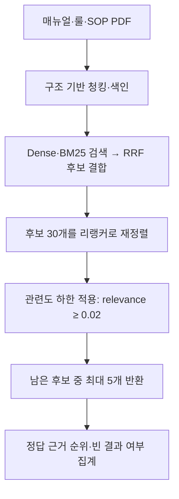

# 새 질문 기준값 검증·o02 실제 Agent 확인 — 2026-10-30

> **읽기 안내:** 이 문서는 2026-10-30 실행 당시의 결과 기록이다.
> 작업의 목적, 관련도 하한 0.02의 의미, 검색/Agent/혼합 검색 테스트의 차이와
> 실제 코드·화면 연결 지점은 [작업 설명·현황 문서](../WORK_STATUS_2026-11-02.md)를 참고한다.
> 아래의 당시 수치·실제 Agent 미완료 기록은 보존하며, 이번 설명 보완으로 새 테스트를 실행하거나
> Haiku의 실제 응답 검증을 완료한 것은 아니다.

## 이 작업은 무엇을 확인하는가

**정비 질문에 필요한 근거는 남기고, 직접 답할 정보가 없는 질문에서는 답을 지어내지
않는지 확인하는 평가다.** 이 보고서는 다음 두 작업을 함께 다룬다.

| 작업 | 입력과 확인 내용 | 완료 상태·한계 |
|---|---|---|
| 새 질문으로 검색 기준값 검증 | PDF 3종에 새 질문 24개를 검색하고, 관련도 하한 없음과 0.02를 비교 | 2026-10-30 측정 완료. 실제 로컬 임베딩·리랭커 사용. Claude 응답은 생성하지 않음 |
| o02 실제 Agent 응답 확인 | “배터리 셀 화재의 소화약제 종류와 진압 절차는”에 자유 대화 Agent가 어떻게 답하는지 검사 | 실제 응답 검토 미완료. 검색 결과만으로 환각 여부를 판단할 수 없음 |

여기서 **검색 오반환**은 직접 답이 없는 질문에도 문서가 반환된 경우다. 예를 들어
SOP에 배터리나 비상계획이라는 표현이 있어 검색되더라도, 요청한 소화약제·진압 절차가
들어 있다는 뜻은 아니다. Agent가 이 한계를 설명하고 멈출 수도 있으므로,
**문서가 검색된 사실과 근거 없는 답변을 생성한 사실은 따로 평가한다.**

이 작업은 평가용 임시 저장소에서 수행한다. 운영 DB 변경, 실제 정비 조치,
PLC 제어, 배포 완료를 확인하는 테스트는 아니다.

## 기준값 0.02와 이 테스트의 관계

### 설정값과 성능 기준선의 차이

| 구분 | 의미 | 이 보고서의 예 |
|---|---|---|
| 관련도 기준값·하한 | 검색 후보를 남길지 결정하는 설정 | `relevance >= 0.02`인 후보만 남김 |
| 성능 기준선 | 변경 전후 비교를 위해 보존한 측정 결과 | 하한 미적용 시 정상 질문 Hit@5 12/12, MRR 0.958 |

`0.02`는 리랭커가 계산한 관련도 점수의 하한이다. **정답률 2%나 답변 신뢰도 2%를
뜻하지 않는다.** 벡터 유사도·RRF 순위 결합 점수·설비 센서 경보 기준과도 다르다.

검색에서 적용하는 순서는 다음과 같다. 이 평가의 후보 수는 30개, 최종 반환은 최대 5개다.

아래는 적용 방식만 설명하는 가상 점수이며 측정 결과가 아니다.

| 후보 관련도 | 0.02 적용 결과 |
|---|---|
| 0.010 | 제외 |
| 0.020 | 포함 가능: 하한과 같은 값도 통과 |
| 0.080 | 포함 가능: 최종 개수 제한은 별도로 적용 |

모두 하한 미만이면 빈 목록을 반환한다. 점수가 누락되거나 유효하지 않으면 오류로
처리하며, 이를 정상적인 “근거 없음”으로 집계하지 않는다. 하한은 통과 후보의 기존
순서를 유지하는 필터이므로, q12·q13의 정답 순위 하락 원인은 별도로 분석해야 한다.

### 왜 새 질문으로 다시 확인했는가

기존 36개 질문에서 살펴본 후보값 `0.02`가 새 문장에서도 정상 근거를 보존하면서
불필요한 반환을 줄이는지 확인하기 위해서다. 새 질문의 점수를 보기 전에 값을 고정하고,
**동일 후보의 점수를 한 번 계산한 뒤 하한 없음과 0.02를 비교**했다.
이번 결과를 보고 기준값을 다시 고르거나 운영값을 자동 변경하지 않았다.

새 질문은 정상 12개와 직접 요청 정보가 없는 12개다. 기존 질문과 문장 중복은 없지만
같은 PDF를 사용하므로, 새로운 문서·새로운 의미 범주 전체로 일반화한 검증은 아니다.
o02는 별도 대조 사례이며 24개 보류셋의 집계에는 넣지 않는다.

### 지표는 어떻게 읽는가

| 지표 | 계산 대상·의미 | 주의점 |
|---|---|---|
| Hit@1·Hit@5 | 정상 질문 12개 중 정답 근거가 상위 1개·5개에 있는 질문 수 | 모든 정답 청크 중 몇 개를 찾았는지 나타내는 Recall@K와 다름 |
| MRR | 정상 질문별 첫 정답 순위의 역수 평균. 예: 1위는 1, 4위는 0.25 | 정상 질문의 순위 성능이며 거절률이 아님 |
| 근거 없음 거절 | 근거 없음 질문 12개 중 검색 결과가 빈 질문 수 | Claude가 실제로 거절했다고 뜻하지 않음 |
| 오반환 | 근거 없음 질문인데 검색 결과가 남은 질문 수 | 최종 답변 환각 여부는 실제 응답 검토가 필요 |

아래 집계는 Python 평가 코드로 계산한 값이다. 이 보고서에는 전체 정답 청크 집합과
관련도 등급을 갖춘 Recall@K·nDCG 평가가 완료됐다는 근거가 없다. 해당 정답표를
보완한 후 계산해야 하며, Hit@5를 Recall@5로 바꿔 표기하지 않는다.

## 실제 코드와 서비스의 어느 부분에 연결되는가

### 설정 → 검색 → 응답 → 화면

| 연결 지점 | 코드·자료 | 이 테스트와의 관계 |
|---|---|---|
| 하한 설정 | [config.py](../../src/weeing_weeing/config.py), [rag/factory.py](../../src/weeing_weeing/rag/factory.py) | `RAG_MIN_RELEVANCE` → `rag_min_relevance` → 검색기의 `min_relevance`로 전달 |
| 검색·하한 적용 | [rag/retriever.py](../../src/weeing_weeing/rag/retriever.py)의 `HybridRetriever.search_hits` | 후보 검색 → 재정렬 → 하한 → 최종 K개 선택 |
| 새 질문 검색 평가 | [validate_rag_holdout.py](../../scripts/validate_rag_holdout.py), [질문 파일](../../data/eval/rag_queries_holdout_v1.toml) | 같은 후보에서 두 하한 조건의 순위·빈 결과를 비교 |
| 실제 o02 평가 | [check_rag_agent.py](../../scripts/check_rag_agent.py) | 평가용 SQLite·검색기·자유 대화 Agent를 연결. HTTP 인증·대화 저장은 제외 |
| 자유 질문의 출처 정책 | [api/chat_knowledge.py](../../src/weeing_weeing/api/chat_knowledge.py)의 `DatabaseChatKnowledge` | DB 승인·현재 판·출처·삭제 상태를 검색 전후와 응답 제출 과정에서 확인 |
| 답변 생성·근거 검토 | [agent/chat.py](../../src/weeing_weeing/agent/chat.py), [chat_grounding.py](../../src/weeing_weeing/agent/chat_grounding.py) | Claude가 도구를 선택하고 답변을 생성. 인용 대상과 주장·근거의 관계를 검토 |
| 서비스 API·저장 | [api/chat.py](../../src/weeing_weeing/api/chat.py), [chat_storage.py](../../src/weeing_weeing/api/chat_storage.py) | 인증·대화 소유권·응답 저장을 연결하는 별도 통합 검증 대상 |
| 화면 | [AssistantPanel.jsx](../../frontend/src/components/dashboard/AssistantPanel.jsx), [ReportDraftModal.jsx](../../frontend/src/components/report/ReportDraftModal.jsx) | 챗봇 패널과 보고서 분석 표시의 연결 확인 대상. 이 검색 테스트만으로 UI 완료 판정 불가 |
| 사건 분석 | [api/analysis.py](../../src/weeing_weeing/api/analysis.py), [agent/analyst.py](../../src/weeing_weeing/agent/analyst.py) | 사건·센서·검색 근거를 분석 결과로 연결. 자유 질문과 다른 경로이므로 별도 회귀 필요 |

위 링크는 원래 저장소의 공통 구현이다. 2026-11-02 추가 평가 코드·테스트 변경은
별도 `o02-validation` worktree에 있으며, 원래 폴더에 자동 반영되지는 않는다.
위치와 최신 상태는 [전체 작업 현황](../WORK_STATUS_2026-11-02.md)에 정리했다.

설정 코드의 하한 기본값은 `None`으로 필터가 꺼져 있다. **이 평가에서 0.02를 사용했다고
운영에서도 활성화됐다는 뜻은 아니다.** 실제 비밀 환경 파일은 확인하지 않았다.
o02 평가 스크립트는 평가용 설정에 0.02를 명시해서 사용한다.

승인·삭제 차단은 관련도 필터와 별개다. 관련도 점수가 높아도 미승인·삭제 자료는
제외해야 한다. 자유 질문의 DB 정책이 사건 분석에도 동일하게 적용되는지는 추가 검증
대상이다. 임베딩·리랭커는 검색 모델이고 Claude는 답변 생성 모델이므로 서로 구분한다.

### 기준값을 사용하지 않는 부분

- [service_v1.toml](../../data/faq/service_v1.toml)의 FAQ 버튼은 검토된 답변을 ID로
  선택한다. 검색·리랭커·Claude를 호출하지 않는다.
- 정비 이력의 정확한 전체 건수·기간 목록은 `query_history`가 DB에서 계산한다.
  검색 상위 5개의 개수를 전체 정비 건수로 사용하지 않는다.
- 저장된 대화·분석·보고서를 조회하는 동작은 재검색이 아니다.
  하한을 바꿔도 기존 답변이 자동으로 다시 생성되지는 않는다.
- 센서 이상 탐지와 PLC 보호 정지 기준은 RAG 관련도 하한과 별개다.

## 사전 고정 조건

- 기준 코드: 최신 dev에 청킹 평가 커밋을 반영한 `f7110f2`와 이번 평가 도구 변경.
- 질의 파일: `data/eval/rag_queries_holdout_v1.toml`, SHA256
  `4515659d729286ef7e34b6185d378a0e1c1623c394310e39b878885f583069ef`.
- 정상 12개, 직접 요청 정보가 없는 질문 12개. 정상 문서는 매뉴얼·룰·SOP 각 4개다.
- 원본 36개와 문장 중복 없음. o02는 보류셋에 넣지 않고 별도 대조 사례로 측정한다.
- 같은 PDF 3종, 구조 기반 청킹, Qdrant 임시 저장소, 후보 30개, 최종 5개.
- 임베딩 `BAAI/bge-m3`, 리랭커 `BAAI/bge-reranker-v2-m3`, 추론 배치 2,
  `OMP_NUM_THREADS=4`, `MKL_NUM_THREADS=4`, 캐시된 모델만 사용한다.
- 점수를 보기 전에 하한을 `0.02`로 고정했다. 같은 후보 점수를 한 번 계산하고
  필터 없음과 `0.02`를 비교한다. 이 자료로 임계값을 다시 선정하지 않는다.
- 평가 자료 목록 SHA256:
  `f3212a8465604f73349612cc4a08a373ce25f055c345caad3891cbf85222ef0c`.
- 문서·의미 범주까지 독립된 시험이 아니며 전문가 검토 전 질의 초안이다.
  근거 없음은 요청한 상세 정보의 부재를 뜻한다. 문서의 적용 한계·거절 근거까지
  무관하다는 뜻은 아니므로 검색 오반환과 Agent의 허위 답변을 구분한다.

## 기준값 결과

Qdrant 임시 저장소의 실제 모델 측정은 24개 보류 질문과 o02 대조를 모두 완료했고
종료 코드 0이다. 리랭커 후보는 질문당 한 번만 채점했으며 같은 점수에서 두 조건을 비교했다.

| 관련도 하한 | Hit@1 | Hit@5 | MRR | 정상 빈 결과 | 근거 없음 거절 | 오반환 |
|---|---|---|---|---|---|---|
| 없음 | 11/12 | 12/12 | 0.958 | 0 | 0/12 | 12 |
| 0.02 | 11/12 | 12/12 | 0.958 | 0 | 7/12 | 5 |

이번 정상 질문의 순위 손실이나 빈 결과는 없었다. n04·n05·n07·n08·n10·n11·n12를
거절했고, n01·n02·n03·n06·n09는 요청한 직접 정보가 없는데도 문서를 반환했다.
문서와 가까운 6개 중 거절은 2개, 다른 범위 6개 중 거절은 5개다.

| 남은 질문 | 요청 정보 | 1위 관련도 | 0.02 적용 후 반환 수 |
|---|---|---|---|
| n01 | 상전류로 절연저항을 계산하는 공식·합격 수치 | 0.0575 | 4 |
| n02 | 실제 베어링 부품번호·구매 가격 | 0.1494 | 4 |
| n03 | 설치 센서 모델의 거리·주변광 정격표 | 0.0852 | 4 |
| n06 | 외함값으로 권선 온도를 환산하는 공식 | 0.3447 | 5 |
| n09 | 타사 PLC 비밀번호 초기화·잠금 해제 절차 | 0.0256 | 1 |

기존 o02 대조도 1위 관련도 0.3736, 하한 적용 후 2개 반환으로 오반환이 재현됐다.
보류셋의 정상 질문 보존과 일부 거절 효과는 확인했지만, 하한 하나로 답변 가능 여부를
보장하지는 못했다. 앞선 구조 기반 36개 평가에서 정상 질문의 반환 1위 최솟값은
0.0905였다. 새 근거 없음 질문 n06의 0.3447을 넘도록 하한을 올리면 그 정상 질문의
모든 반환 후보도 탈락하므로, 두 평가에서 무손실 완전 거절을 동시에 보장할 수 없다.
이번 자료로 기준값을 재선정하지 않았고 운영 기본값도 변경하지 않았다.

세부 측정값은 [원본 집계](report-2026-10-30-holdout-results.md)를 참고한다.

## 실제 o02 Agent — 2026-10-30 당시 기록

**실제 응답 확인은 미완료다.** 유료 실행 명령의 도구 승인 요청이
`rejected by user`로 거절돼 프로세스가 시작되지 않았다. 이번 작업의 실제 Agent
API 호출은 0회이며 실제 응답·상태·모델·토큰 수를 측정하지 못했다.
이 결과를 Agent의 거절 성공이나 오답으로 해석하지 않는다.

실행 도구는 준비됐다. 평가용 SQLite에 PDF 3종을 등록하고 실제
`DatabaseChatKnowledge`의 승인·판·해시·출처 검사와 자유 대화 Agent를 연결한다.
운영 DB·색인은 사용하지 않으며 HTTP 인증·대화 저장은 시험 범위가 아니다.
계획은 `claude-sonnet-5-5 / medium`, 300초, 대화 4턴·근거 검토 2회 이내다.
SDK 인증 객체 생성과 호출 없는 실행 계획을 확인했지만 공급자 인증·모델 접근이
성공했다고 판단한 것은 아니다. 현재 `AGENTS.md`에 따라 이후 인증 확인·실제 유료
실행은 사용자가 자기 터미널에서 직접 수행한다. AI는 비밀 파일·SDK 인증 프로필을
열거나 실제 `.env`를 로드하지 않으며, 자동 검증에는 가짜 클라이언트만 사용한다.

예상 상태는 `INSUFFICIENT_EVIDENCE` 또는 `OUT_OF_SCOPE`다. 실행 시 소화약제·
진압 절차를 근거 없이 만드는지도 검토해야 한다. Agent에게 검색 결과를 강제로
주입하지 않으며, 검색 없이 답한 경우와 오반환을 읽고 거절한 경로를 구분한다.

### 실제 응답에서 추가로 확인할 내용

위 Sonnet 설정은 당시 계획의 기록이다. 현재 요청 모델은 `claude-haiku-5-5`이며,
그 모델의 접근 가능 여부와 실제 응답 모델 일치는 아직 확인된 결과로 기록하지 않는다.
인증 확인과 실제 유료 실행은 사용자가 자기 터미널에서 수행한다.

검색 평가와 달리 실제 Agent 평가는 **질문 → 도구 선택 → 실제 검색 청크 → 답변·출처**를
함께 확인한다. 실행 전 검색 점검에서 얻은 청크를 Agent에게 강제로 넣지 않으므로,
사전 검색 결과와 Agent가 실제로 읽은 근거도 구분해서 기록해야 한다.

| 확인 항목 | 기록할 내용·판정 기준 |
|---|---|
| 검색 여부와 근거 | 검색 도구 호출 여부, 반환 청크·출처, 정답 근거 유무·순위. 정답이 없는 질문의 정답 순위는 해당 없음 |
| 상태와 답변 내용 | 예상 상태 일치 여부와 별도로, 실제 본문이 근거 한계를 설명하는지 확인 |
| 인용 정확도 | 현재 검색에서 얻은 유효 출처인지, 인용 본문이 해당 주장을 뒷받침하는지 대조 |
| 환각 여부 | o02의 소화약제·진압 절차 및 n01·n02·n03·n06·n09의 공식·수치·품번·가격을 근거 없이 만드는지 확인 |
| 실패 원인 | 필요한 근거 누락·순위 문제는 검색 실패, 가져온 근거를 넘는 주장은 생성 실패로 구분. 인증·통신·실행 오류는 별도 기록 |
| 수정 필요 여부 | 검색·출처 정책·생성·실행 환경 중 어느 부분을 수정할지 근거와 함께 기록 |

상태 코드만 맞아도 본문에 없는 절차를 적었다면 통과로 볼 수 없다. 반대로 검색 결과가
남았다는 이유만으로 환각으로 판정하지 않는다. n01·n02·n03·n06·n09 역시 같은 방식의
실제 응답 평가가 남아 있다. 가짜 클라이언트 테스트는 도구 연결·예외 처리·기록 형식을
검증하며, 실제 Haiku의 답변 품질을 검증한 결과를 대신하지 않는다.

## 검증과 산출물 — 2026-10-30 당시 기록

- 새 질문의 문장 중복·정답 본문·집계 검사와 실제 SQLite·검색·Agent 연결을 가짜 LLM으로 검증했다.
- 사전 통합 테스트는 첫 실행에서 테스트 대역의 BM25 구성 누락으로 실패했다.
  대역에 실제 BM25 인코더를 연결한 뒤 관련 테스트 7개와 아래 전체 검사를 통과했다.
- `PYTHONUTF8=1`의 전체 `make check`: **1,246 passed, 6 skipped, 3 warnings**.
  Ruff 린트·포맷 및 스킬 사본 동기화 통과. 건너뜀은 Windows 링크 권한 1개,
  선택 실행 실제 모델 스모크 4개, PostgreSQL 전용 검사 1개다.
- 경고는 Chroma legacy embedding config 2건과 Qdrant 서버 버전 확인 1건이다.
- 초기 전체 검사에서는 별도 수정된 기존 도구 설명문의 줄 끝 공백 때문에 포맷 검사가
  실패했다. 줄바꿈은 보존하고 공백만 정리한 뒤 위 전체 검사를 통과했다.
- 실행 방법: [RAG_HOLDOUT](../RAG_HOLDOUT.md).
- 로컬 검색 원본: `outputs/rag_e2e/holdout-2026-10-30-v1/`.
- Agent 원문 응답·호출 지표는 Git 제외 로컬 출력 폴더에만 저장한다.
  이번 유료 실행이 거절돼 해당 폴더·원문은 생성되지 않았다.

## 2026-11-02 설명 보완 시점의 상태와 다음 작업

위 `1,246 passed`는 당시 검사 결과다. 이후 평가 worktree의 전체 검사는
**Ruff 통과, pytest 1,337 passed / 6 skipped / 3 warnings / 12 errors**로,
전체 검사가 통과한 상태는 아니다. 12건은 새 혼합 검색 테스트의 준비 데이터가
`ReportFormData`에 없는 `remarks` 필드를 전달해 발생한 오류다.
해당 오류로 혼합 검색의 본문 검증까지 완료되지 않았으며, 이번 문서 보완으로 해결하지 않았다.

PDF·승인 보고서 혼합 검색 검사는 이 보고서의 PDF 3종·24질문 검색 실측과 별도다.
현재 새 혼합 테스트는 가짜 임베딩·LLM을 사용하고 리랭커·0.02 하한을 적용하지 않으므로,
이를 통과해도 0.02의 검색 품질이 입증되는 것은 아니다.

| 구분 | 앞으로 할 작업 | 완료 판단에 필요한 근거 |
|---|---|---|
| API 없이 진행 | 혼합 검색 준비 데이터 오류 수정·재검증 | 승인 문서·보고서 인용 및 미승인·삭제·검색 후 삭제 차단 결과 |
| API 없이 진행 | q12·q13 순위 하락 분석 | 동일 질문·문서로 청킹 전후의 후보·리랭커 순위·정답 청크 비교 |
| API 없이 진행 | 사건 분석 회귀·UI·운영 점검 | 경로별 승인·삭제 차단, 센서·출처 유지, 응답 상태·화면 연결 확인 |
| API 없이 진행 | 지표·질의별 평가표 보완 | 정답 청크·관련도 등급을 정의하고 Python으로 Recall@K·MRR·nDCG 계산 |
| 실제 API 필요·보류 | o02와 남은 5개 실제 Agent 응답 평가 | 실제 사용 모델·응답·검색 청크·정답 근거를 대조한 인용·환각·실패 원인 기록 |

이번 수정은 작업 의미·기준값·연결 지점의 설명 보완이다. 프로그램 코드는 변경하지 않았고,
새로운 검색 실측이나 실제 API 호출을 수행하지 않았다. 전체 작업의 우선순위·보호 설정의
남은 확인 사항은 [전체 작업 현황](../WORK_STATUS_2026-11-02.md)을 참고한다.
